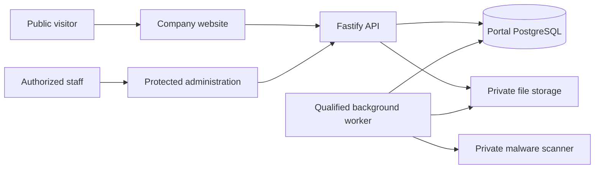

# Onesa UG Company Portal

Server gateway imports and traced-bundle checks keep the Node trust policy in
serverless artifacts as well as conventional Node startup.

Node application startup has a narrowly scoped CA trust policy, with isolated
regressions in `node --test scripts/test_tls_trust.mjs`. Use Node 24.12+ in the 24
series. Source implementation is separate from the accepted component releases
recorded below; no production update follows merely from merging source.

Production API hosting moved to the existing Oracle Free VM on 2026-10-16; the
Vercel frontend and existing data services remain. See the
[verified hosting cutover](docs/engineering/DEPLOYMENT.md)
for source identities, protected ingress, acceptance and rollback.

The current accepted Company/Portal frontend is
`2009ee656cc685657956d63abef93860a850905b` (2026-10-23), Vercel
`dpl_GppJgy5SWD1vAwo2hda6TmuwQKmB`. The independently accepted Oracle API is
`391b23ddb28b28b1467cf307c696544a9e9476a3`, with the identical qualified source
tree. Administrator and Engineering Docs sign-in offer an unchecked-by-default
**Remember this browser** option for the existing eight-hour session limit.
Purpose-signed session evidence preserves actual MFA freshness across renewal;
existing Portal access and separate Engineering membership remain enforced.
Approved new administrators have a dedicated authenticator/recovery-code setup UI.
This scope does not unify AI Platform or Robot accounts.

Full native dev/staging/main checks, 154 isolated backend tests, two actual
synthetic staging MFA sessions, 20 source-equivalent Preview UI contexts and six
canonical responsive/accessibility contexts passed. Running-image cookie/TLS and
private-boundary checks passed in production. Canonical UI submissions were
intercepted, so they do not establish production-owner authentication or delivered
email. The Home hero, credentials, memberships, governance records and worker are
retained. Later repository metadata commits are distinct from serving components.

The earlier accepted Company/Portal frontend is
`63d8c8682735ae24076890f751a1a06936bb6d11` (2026-10-22), Vercel
`dpl_BrSELH5kadPHJgNjMckzzNtTgBVs`. Products now presents Application Security
in English/German as an AI Platform application direction, with code review,
threat modelling, vulnerability triage, human-reviewed remediation and contextual
contact navigation. This does not claim an available security scanner or certification.
Next.js 16.4.2 is verified in the sealed frontend artifact. Full native checks,
48 staged general views and 12 feature/contact journeys, then 16 canonical views
and 12 canonical feature/contact journeys passed. The Home hero, authentication,
API, worker and memberships remain unchanged. The public Company host intentionally
denies private API routes; authenticated APIs and readiness use the Portal host.

Protected Engineering Docs source `373889be9bda3357ff50b74692e9b75637e2bb59`
is separately accepted at `docs.engineering.onesa.eu`, Pages
`2d937ff1-391f-4156-8df6-75d2d14aaa5e`, with DOMPurify 3.4.17 and factual
synthetic-demo documentation. All 751 protected assets and anonymous denials,
18 production responsive/accessibility views, 22 manuals and 87 diagrams pass.
Actual approved-owner access and supported Access logout/refusal were observed;
this did not change membership, passwords or provider policies. Repository metadata
commits remain distinct from each serving component's source.

The preceding accepted Company/Portal frontend is `5cfd9d40af20f5a040a79c5868a15c7d5fd72862`
(2026-10-22), deployment `dpl_DU2RKSAuXnVypzvTnPbjL7QHWqZG`. Engineering Docs
retains its opening state during both sign-in callbacks;36 staged and12 canonical
synthetic UI cases pass after full exact-source CI. Both canonical deployment
identities and the Engineering Docs redirect are verified. The Home hero, API,
worker and memberships are unchanged. Approved owner access to Engineering Docs
was verified separately. Protected edition `34e9ab83c412fc87183a1428537ae0547a22ed04`
is accepted at `docs.engineering.onesa.eu`, Pages
`48d6eebd-3692-4241-87c1-df6e1d37ef4d`: each environment passed 751 protected
file checks and anonymous denials, 18 responsive/accessibility views, 22 manuals
and 87 diagrams. These Portal UI cases sent no real email or model request.

This retains the preceding frontend `3fcbde97f9a6d9b3e6eec8ae1e3870709bc4e691`
(2026-10-22). Products includes Industrial AI troubleshooting and the wider application
areas in English/German. Full native checks,36 staged text/accessibility views,
12 image-loading views and eight canonical production views pass. The Home hero
and compact product preview are unchanged; no backend activation accompanies it.

This includes the previous focused-topic and cross-browser edition
`32f3b24c4937632d2da500b44002602bdedd8449`: each homepage capability row opens its
own English/German Technology topic, preserving the complete overview and bookmarks.

Engineering Docs email links can open in another browser through an encrypted,
origin-bound handoff of at most five minutes and fresh receiving-browser OIDC
state/PKCE. Explicit confirmation of the shown email precedes one-use redemption.
The original 15-minute link expiry, current membership, Origin/CSRF and admin MFA
remain enforced. Sent is one plain message; email stays visibly disabled and
explicit resend enables after five seconds.

The earlier independently accepted Oracle API is `cfe0d43e7032dabc83be8e49dba340660e1975e0`,
whose complete tree equals qualified main `32f3b24c4937632d2da500b44002602bdedd8449`.
Twenty-five isolated real identity integration checks, full exact-main CI,
30 staged/six canonical synthetic UI views and 144 topic journeys pass. Actual
staged/production API checks verify affected methods, database TLS and five HTTP
boundaries. Synthetic transport does not establish real owner inbox receipt or
approved production Docs access.

Worker `8bf6fd60c0b3ca225816f7404afdce1d80d4e1a5`, scanner, AI and Robot remain
independently retained. No migration, credential change, business-record test write
or real email accompanied this release. Protected Engineering Docs publication and
owner walkthroughs remain separately tracked. The owner reports iPhone17ProMax,
iOS27.0.1 and working VoiceOver; changed topic links have no new physical-device
acceptance claim. See [CHANGELOG.md](CHANGELOG.md) for component history.

The previously accepted About leadership update is frontend `a5c742cfa305f039be9e1ec4b76ed57c025ed8ed` at Vercel `dpl_BNXcsQvXM7S5NbmNrr3VB9pwkmhC`.
The owner-supplied portrait and engineering/renewable-energy biography passed source
CI and staged/canonical responsive accessibility checks. Backend, worker, scanner and
identity services are retained. See the
[About release](docs/engineering/DEPLOYMENT.md).

The previously accepted company-first Home and concise Engineering Docs sign-in frontend
`56eb17c80cfff656608005c60c3ca8d2c9da09a2` is accepted at Vercel `dpl_BcvxvfeoSCa3zLapdrWx1F5wAXZh` on the existing Company/Portal
hosts. API `4e47e3102a3a90054725cc06ad46b95339e0e544`, worker `3fad26e` and scanner remain independently retained.
No backend activation or migration accompanied this frontend release. See the
[earlier Company/sign-in release](docs/engineering/DEPLOYMENT.md).

The 2026-10-18 editorial/task release is accepted; see the
[earlier editorial/API identities and acceptance](docs/engineering/DEPLOYMENT.md).

Onesa UG is the company. Its product hierarchy is Onesa AI Platform—Applications
and the planned Industrial AI track—and Onesa Robotics / Physical AI. Product
status and each demonstrated capability remain distinct from integration directions.

The Company Portal is Onesa UG’s corporate website and protected business workspace.
It combines an English/German public site with a custom CMS, enquiries, recruitment,
private documents, background processing and database-backed privacy governance.
Public content requires editorial approval; private records require backend authorization.
Engineering Docs can use separately qualified Portal email-link/password sign-in with
owner-managed individual memberships; this grants no Portal administrator role.
First-time users register and verify their email before owner review. Existing
explicit approvals are retained; new administrator access keeps MFA.
Approved new administrators can enroll an authenticator and save recovery codes
through the registration UI. An existing MFA enrollment cannot be overwritten.
Administrator and Engineering Docs sign-in offer **Remember this browser**,
unchecked by default, for protected cookie persistence within the existing
8-hour session lifetime. It does not save passwords or skip MFA. Use it only on
a private device and sign out when finished. Browsers may restore session cookies
when restoring tabs even without this option; closing a window is not revocation.
An already authenticated Portal account can continue to Docs only with its
existing enabled Engineering membership; other product permissions stay separate.
Legacy sessions can continue using Portal. Reusing them for Docs requires a fresh
MFA sign-in so an older session renewal cannot be mistaken for authentication.
See the [protected access procedure](docs/engineering/ENGINEERING_DOCS_IDENTITY.md)
for source behavior, deployment records and onboarding boundaries.
The protected privacy workspace includes policy review and explicit Portal lifecycle
controls: read-only impact plans, preservation holds and owner-confirmed erasure.
Draft rules never activate automatic expiry. See the [governance architecture](docs/engineering/PRIVACY_GOVERNANCE.md)
and [release checklist](RELEASE_CHECKLIST.md) for source behavior and deployment status.



| Directory | Responsibility |
| --- | --- |
| `onesa-company-portal-frontend/` | Next.js 16 / React 19, public site and administration |
| `onesa-company-portal-backend/` | Fastify / TypeScript, APIs, migrations, CMS and worker |
| `infra/` | Deployment, private scanner and operational configuration |
| `scripts/` | Contracts, local verification and controlled release tooling |
| `docs/` | Engineering references; restricted evidence is excluded from Git |

Use Node 24 and a disposable PostgreSQL database for integration tests. Docker is optional
for native development and required for container/recovery qualification. Locked installs:

```sh
npm --prefix onesa-company-portal-backend ci
npm --prefix onesa-company-portal-frontend ci
```

Copy `.env.example` to an ignored `.env` only when no environment file exists; privately
configure local database and storage values. Never use production credentials or replace
an existing environment. `python3 scripts/bootstrap-env.py` provides the existing local
setup helper. Full command contexts, prerequisites and side effects are in
[Build and test](docs/engineering/BUILD_AND_TEST.md).

```sh
npm --prefix onesa-company-portal-backend run dev
npm --prefix onesa-company-portal-frontend run dev
```

These commands run in separate terminals. The frontend uses port 3300; its server proxy
uses `BACKEND_URL`. Cloud storage, email and malware scanning require their actual
configured dependencies; local rendering does not establish hosted operation.

```sh
npm --prefix onesa-company-portal-backend run lint
npm --prefix onesa-company-portal-backend run typecheck
npm --prefix onesa-company-portal-frontend run lint
npm --prefix onesa-company-portal-frontend run typecheck
npm --prefix onesa-company-portal-frontend run build
node scripts/test_system_appearance.mjs
python3 scripts/validate-docs.py
python3 scripts/repository_hygiene.py
```

Backend `npm test` requires `TEST_DATABASE_URL` ending `_test` and truncates its fixture
tables. Browser tests require the isolated seeded API/frontend and installed browsers.
Never run fixture tests against application data. Generate APIs from Fastify schemas;
[contracts](docs/api/API.md) explain the deterministic client pipeline.

Onesa uses one shared visual foundation with distinct product interfaces. Light/dark
appearance follows the browser/OS preference, including live changes; no application
selector, stored appearance override or clock schedule exists. Administration and public
content have distinct shells and access boundaries.
The public mobile menu works before JavaScript loads. Pending client navigation shows
a localized status while fresh approved content is fetched, retaining the current page
and true missing-page HTTP responses. Optional homepage content does not block the hero. Section copy, listings and related
stories stream independently with bounded public reads. A genuine missing detail keeps
HTTP404; a transient content outage shows a localized noindex retry state. Required
publication and detail checks stay fresh, preserving the browser/OS appearance.

Vercel hosts the frontend; the existing Oracle VM hosts the API and qualified private
worker/scanner services. Governance currently contains draft policies; deployment does not approve
retention, processor contracts, legal publication or applicant/customer processing.
The owner-authorized pre-launch runtime mode enables existing public features while legal prerequisites remain explicitly unapproved. Default launch mode restores their global publication hold. Editorial review and every protected-data boundary remain enforced; see the deployment procedure.
Free-provider wakeups and capacity limits are documented, without an uptime guarantee.

Keep three permanent branches: `dev`, `staging`, `main`. Temporary Dependabot security-update
and necessary narrow security-release branches are allowed. Normal fixes integrate through
`dev → staging → main`; bot PRs target default main and receive isolated tests, never
automatic production deployment. Urgent fixes exclude unfinished work and require isolated
staging qualification, owner release and reconciliation into development.
Review [agent policies](AGENTS.md), [deployment](docs/engineering/DEPLOYMENT.md) and
[qualification](docs/engineering/AUTOMATED_QUALIFICATION.md). Current CI is available in
[GitHub Actions](https://github.com/DruHustle/onesa-company-portal/actions).
[Onesa Developer Docs](https://docs.onesa.eu) contains approved public guides;
[Onesa Engineering Docs](https://docs.engineering.onesa.eu) requires authorized access
and includes Architecture & Workflows, Engineering Onboarding and the design system.

## Private vulnerability reporting

Report privately to [info@onesa.eu](mailto:info@onesa.eu), or GitHub private vulnerability
reporting when enabled. Include the affected version, safe reproduction steps and impact.
Do not post sensitive details publicly or send passwords, CVs or customer records.
Support covers the latest reviewed main revision; no response SLA, bounty or historical
version support is promised.

Maintained by Onesa UG (haftungsbeschränkt), Heidelberg, Germany. No project software
license has been assigned; dependency and model licenses do not grant an Onesa license.
