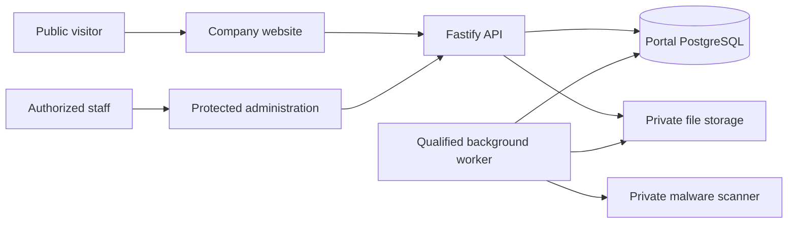

# Onesa UG Company Portal

Server gateway imports and traced-bundle checks keep the Node trust policy in
serverless artifacts as well as conventional Node startup.

Node application startup has a narrowly scoped CA trust policy, with isolated
regressions in `node --test scripts/test_tls_trust.mjs`. Use Node 24.12+ in the 24
series. Source implementation is separate from the accepted component releases
recorded below; no production update follows merely from merging source.

Production API hosting moved to the existing Oracle Free VM on 2026-10-16; the
Vercel frontend and existing data services remain. See the
[verified hosting cutover](docs/engineering/DEPLOYMENT.md)
for source identities, protected ingress, acceptance and rollback.

Independently accepted frontend, API, worker and operations-monitor revisions are
recorded in [CHANGELOG.md](CHANGELOG.md). Treat those dated component releases
separately from repository branches and CI results. Detailed deployment receipts,
installed hashes and current serving records remain in protected engineering custody.
The accepted protected Docs edition and its verified access scope are also recorded
there; a prepared archive or a successful link request does not establish a new
protected publication or approved-account sign-in.

Engineering Docs email links can open in another browser through an encrypted,
origin-bound handoff of at most five minutes and a fresh receiving-browser OIDC
state/PKCE exchange. Explicit confirmation precedes one-use redemption. The original
15-minute link expiry, current membership, Origin/CSRF and administrator MFA remain
enforced. After an accepted request, Sent is plain text; the email input and send
control are visibly disabled. Explicit resend enables after the 30-second server
window, with concurrent and repeated requests coalesced. Delivery and actual owner
access require their own evidence.

Administrator MFA state is disclosed only after valid password or bearer-link proof.
Enrolled accounts receive the factor step; approved accounts without a factor receive
authenticator setup. Discovery creates no session and does not replace an existing
factor. On a new empty database, the bootstrap owner enrolls and verifies MFA in the
UI; bootstrap does not activate or print an unverified secret.

Onesa UG is the company. Its products are Onesa AI Platform—Applications and
Industrial AI—and Onesa Robotics / Physical AI. The isolated Industrial Investigation
software demonstration uses synthetic data; ordinary AI production keeps Industrial
disabled. Wider factory integrations and physical robotics remain development
directions, distinct from demonstrated functionality.

The Company Portal is Onesa UG’s corporate website and protected business workspace.
It combines an English/German public site with a custom CMS, enquiries, recruitment,
private documents, background processing and database-backed privacy governance.
Public content requires editorial approval; private records require backend authorization.
Engineering Docs can use separately qualified Portal email-link/password sign-in with
owner-managed individual memberships; this grants no Portal administrator role.
First-time users register and verify their email before owner review. Existing
explicit approvals are retained; new administrator access keeps MFA.
Approved new administrators can enroll an authenticator and save recovery codes
through the registration UI. An existing MFA enrollment cannot be overwritten.
Administrator and Engineering Docs sign-in offer **Remember this browser**,
unchecked by default, for protected cookie persistence within the existing
8-hour session lifetime. It does not save passwords or skip MFA. Use it only on
a private device and sign out when finished. Browsers may restore session cookies
when restoring tabs even without this option; closing a window is not revocation.
An already authenticated Portal account can continue to Docs only with its
existing enabled Engineering membership; other product permissions stay separate.
Legacy sessions can continue using Portal. Reusing them for Docs requires a fresh
MFA sign-in so an older session renewal cannot be mistaken for authentication.
See the [protected access procedure](docs/engineering/ENGINEERING_DOCS_IDENTITY.md)
for source behavior, deployment records and onboarding boundaries.
The protected privacy workspace includes policy review and explicit Portal lifecycle
controls: read-only impact plans, preservation holds and owner-confirmed erasure.
Draft rules never activate automatic expiry. See the [governance architecture](docs/engineering/PRIVACY_GOVERNANCE.md)
and [release checklist](RELEASE_CHECKLIST.md) for source behavior and deployment status.



| Directory | Responsibility |
| --- | --- |
| `onesa-company-portal-frontend/` | Next.js 16 / React 19, public site and administration |
| `onesa-company-portal-backend/` | Fastify / TypeScript, APIs, migrations, CMS and worker |
| `infra/` | Deployment, private scanner and operational configuration |
| `scripts/` | Contracts, local verification and controlled release tooling |
| `docs/` | Engineering references; restricted evidence is excluded from Git |

Use Node 24 and a disposable PostgreSQL database for integration tests. Docker is optional
for native development and required for container/recovery qualification. Locked installs:

```sh
npm --prefix onesa-company-portal-backend ci
npm --prefix onesa-company-portal-frontend ci
```

Copy `.env.example` to an ignored `.env` only when no environment file exists; privately
configure local database and storage values. Never use production credentials or replace
an existing environment. `python3 scripts/bootstrap-env.py` provides the existing local
setup helper. Full command contexts, prerequisites and side effects are in
[Build and test](docs/engineering/BUILD_AND_TEST.md).

```sh
npm --prefix onesa-company-portal-backend run dev
npm --prefix onesa-company-portal-frontend run dev
```

These commands run in separate terminals. The frontend uses port 3300; its server proxy
uses `BACKEND_URL`. Cloud storage, email and malware scanning require their actual
configured dependencies; local rendering does not establish hosted operation.

```sh
npm --prefix onesa-company-portal-backend run lint
npm --prefix onesa-company-portal-backend run typecheck
npm --prefix onesa-company-portal-frontend run lint
npm --prefix onesa-company-portal-frontend run typecheck
npm --prefix onesa-company-portal-frontend run build
node scripts/test_system_appearance.mjs
python3 scripts/validate-docs.py
python3 scripts/repository_hygiene.py
```

Backend `npm test` requires `TEST_DATABASE_URL` ending `_test` and truncates its fixture
tables. Browser tests require the isolated seeded API/frontend and installed browsers.
Never run fixture tests against application data. Generate APIs from Fastify schemas;
[contracts](docs/api/API.md) explain the deterministic client pipeline.

Onesa uses one shared visual foundation with distinct product interfaces. Light/dark
appearance follows the browser/OS preference, including live changes; no application
selector, stored appearance override or clock schedule exists. Administration and public
content have distinct shells and access boundaries.
The public mobile menu works before JavaScript loads. Pending client navigation shows
a localized status while fresh approved content is fetched, retaining the current page
and true missing-page HTTP responses. Optional homepage content does not block the hero. Section copy, listings and related
stories stream independently with bounded public reads. A genuine missing detail keeps
HTTP404; a transient content outage shows a localized noindex retry state. Required
publication and detail checks stay fresh, preserving the browser/OS appearance.

Vercel hosts the frontend; the existing Oracle VM hosts the API and qualified private
worker/scanner services. Governance currently contains draft policies; deployment does not approve
retention, processor contracts, legal publication or applicant/customer processing.
The owner-authorized pre-launch runtime mode enables existing public features while legal prerequisites remain explicitly unapproved. Default launch mode restores their global publication hold. Editorial review and every protected-data boundary remain enforced; see the deployment procedure.
Free-provider wakeups and capacity limits are documented, without an uptime guarantee.

Keep three permanent branches: `dev`, `staging`, `main`. Temporary Dependabot security-update
and necessary narrow security-release branches are allowed. Normal fixes integrate through
`dev → staging → main`; bot PRs target default main and receive isolated tests, never
automatic production deployment. Urgent fixes exclude unfinished work and require isolated
staging qualification, owner release and reconciliation into development.
Review [agent policies](AGENTS.md), [deployment](docs/engineering/DEPLOYMENT.md) and
[qualification](docs/engineering/AUTOMATED_QUALIFICATION.md). Current CI is available in
[GitHub Actions](https://github.com/DruHustle/onesa-company-portal/actions).
[Onesa Developer Docs](https://docs.onesa.eu) contains approved public guides;
[Onesa Engineering Docs](https://docs.engineering.onesa.eu) requires authorized access
and includes Architecture & Workflows, Engineering Onboarding and the design system.

## Private vulnerability reporting

Report privately to [info@onesa.eu](mailto:info@onesa.eu), or GitHub private vulnerability
reporting when enabled. Include the affected version, safe reproduction steps and impact.
Do not post sensitive details publicly or send passwords, CVs or customer records.
Support covers the latest reviewed main revision; no response SLA, bounty or historical
version support is promised.

Maintained by Onesa UG (haftungsbeschränkt), Heidelberg, Germany. No project software
license has been assigned; dependency and model licenses do not grant an Onesa license.
