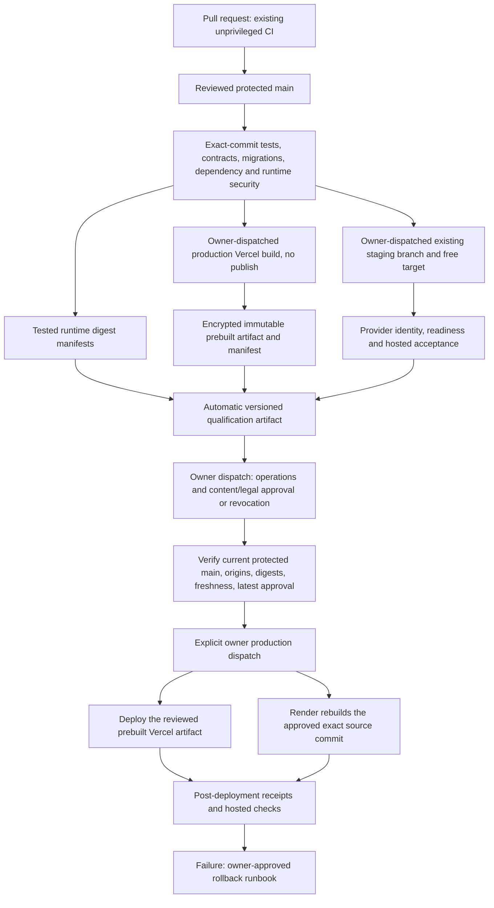

# Automated release qualification

Implemented locally on `release/automated-qualification`; remote activation and hosted
acceptance remain pending. This supplements the legacy secret gate until migration is
verified. It does not authorize a production deployment or approve business/legal matters.

## Architecture



## Evidence and trust

`scripts/release/evidence.py` reads GitHub API workflow/job results, and downloads
immutable artifacts by run and artifact ID. It verifies the API archive SHA256 before
parsing a single bounded JSON member. It never extracts or executes PR artifacts.
The fixed repository owner is `DruHustle`; all privileged workflows require a new
owner dispatch on an allowlisted branch. Re-runs are rejected: create a new run and
new review. Workflow path, event, repository, head repository, commit, branch,
completion and actor are verified. CI must be the latest push run for the exact SHA.
Missing/skipped/cancelled jobs block; failed jobs fail qualification. Existing CI
job names, database services, security scanners and vulnerability gates are retained.

Source fingerprints call the **existing `qualify.py.source_hash()`** unchanged:
sorted tracked plus nonignored untracked paths, path bytes, NUL separator and SHA256
of each file. Outputs live in runner temporary directories or ignored `data/`.
Source fingerprinting occurs on a clean checkout. The entire source fingerprint is
also the conservative content/legal version: any source change requires new approval.

Runtime manifests are uploaded only after the existing image-security gate succeeds.
The approved Vercel production build is encrypted using Node's built-in AES-256-GCM
with random nonce and repository/commit authenticated binding. Plain build archives
and provider files are never uploaded. Deployment restores that exact build and checks
both encrypted and plaintext digests. Render's existing API rebuilds an exact source
commit; binary equivalence to the tested image is **not claimed**. Backend dependencies
and image digests are still recorded and security jobs remain mandatory.

Review records are artifacts from `release-review.yml`, rather than committed files
or caller-provided JSON. Owner dispatch records operations and legal/content decisions,
GitHub-observed owner identity/run creation time, candidate SHA, source/content version,
qualification digest, target `Production` and build digests. A referenced open
owner-authored repository issue/PR contains the operator's monitoring, alert, backup,
recovery, worker, resource-limit and rollback evidence. Its mere existence never
approves the release: both explicit review choices must be `approved`.

Qualification, staging and approval expire after **24 hours**. The most recent review
run for the candidate controls promotion; pending/failed/newer/revocation runs block
older approvals. Closing the owner review issue also revokes it. Revalidation occurs
before every provider job; review and production workflows share `production-deployment`
concurrency. Already-started provider changes cannot be undone by later revocation.

Main must have the repository's prepared classic branch policy: required PRs, strict
up-to-date checks bound to GitHub Actions, administrator enforcement, no PR bypass
actors, no force push/deletion. The validator compares actual required checks with
`docs/development/branch-protection/main.branch-protection.json`. Ruleset-only policies
need a reviewed verifier adapter; they are not silently accepted.

## Workflow and file inventory

Modified: `.github/workflows/verify.yml`,
`.github/workflows/deploy.yml`, `scripts/deploy_render.py`, this guide's links in
`docs/engineering/VERCEL_RENDER.md`, and the existing changelog/release checklist.

Added: `.github/workflows/release-qualification.yml`, `release-build.yml`,
`release-staging.yml`, `release-review.yml`; `scripts/release/evidence.py`,
`hosted.py`, `hosted_suite.py`, `bundle.mjs`, `test_evidence.py`; this guide.

- Existing CI: all current software/database/browser/contract/security checks, plus
  failure-path release tests and sanitized tested-image manifests.
- Qualification: credential-free automatic `workflow_run` on CI/hygiene/build/staging
  completion, or manual dispatch with a staging run ID. Automatic runs only qualify
  an upstream candidate equal to the current main SHA; stale upstream runs are ignored.
- Build: owner-dispatched production-config build on protected main; no provider publish.
- Staging: manual owner dispatch on `audit/portal-master-acceptance`, retaining existing target mappings.
  No database bootstrap, migration or paid provisioning. The sole environment write is
  the actual verified Preview origin on the allowlisted existing staging API, followed
  by readback; provider/database credentials and all other runtime settings are preserved.
- Review: explicit owner dispatch on main, operations and legal choices default blocked.
- Deploy: existing independently selectable frontend/backend/both flow. The portal
  still includes the existing worker gate. Add `approval_run` for the artifact path.
- Post-deployment: records provider IDs/revisions and readiness checks. Unavailable
  application-error, authenticated, storage/monitoring/inference checks remain
  blocked until the corresponding configured probes succeed. It reads protected
  metrics to verify actual request signals and zero observed 5xx responses, and uses
  owner-provisioned synthetic production fixtures for access/storage/AI stream smoke.
  Provider build success never suffices.

The AI staging path retains its existing unavailable-inference core acceptance when
no full fixture set is supplied. Full release acceptance uses `hosted_suite.py` with
owner-provisioned synthetic accounts, real inference/embeddings, streamed message
completion, authenticated ownership/CSRF checks and synthetic storage roundtrip. Portal
uses synthetic administrator/restricted accounts, MFA, confidential PNG storage/scanner
roundtrip and access denial. No editorial approval/publication flags are changed.
The known isolated staging database identity is verified before probes. Unconfigured
fixtures and unavailable model/storage/scanner checks block qualification. Target configuration and actual hosted execution remain required. Production
probes observe application 5xx metrics and request signals; this bounded post-deploy
sample complements owner-reviewed continuous alert/log monitoring rather than
certifying long-term operation.

## Illustrative artifact (cannot approve a release)

```json
{
  "schema_version": 1,
  "repository": "DruHustle/onesa-company-portal",
  "workflow_run_id": "<observed Actions run ID>",
  "candidate_commit": "<exact candidate SHA>",
  "reviewed_commit": "<exact candidate SHA>",
  "valid_for_source_sha256": "<computed by existing source_hash>",
  "CODE_VERIFIED": "BLOCKED",
  "STAGING_VERIFIED": "BLOCKED",
  "OPERATIONS_VERIFIED": "BLOCKED",
  "CONTENT_LEGAL_APPROVED": "BLOCKED",
  "qualification_status": "BLOCKED",
  "approval_provenance": null
}
```

Existing container candidate packaging and AI documentation hosting workflows remain
separate; none is used as a production application qualification source.

Actual records also include observed verification timestamps, test/job references,
build/security identifiers/digests, staging receipts, environment and approval provenance.
No credential values, database URLs, user records, raw vulnerability reports or private
company documents are evidence artifacts. Artifacts retain seven days; their 24-hour
validity is shorter. Expiry/deletion means rebuild/requalify/review, never a fallback to
an arbitrary file or a different candidate.

## Verified GitHub capability readback — 2026-10-11

Read-only API inspection observed all three repositories are **public**, default branch
`main`, with no main classic protection (404) and no rulesets. Production environments
exist with no required reviewers/branch policy; AI also has `Staging` with a custom
branch policy. No setting was changed. The authenticated user API did not expose a
plan name; the selected local operating policy is GitHub Free, not a newly verified
subscription claim.

GitHub Free supports required environment reviewers for public repositories. Required
reviewers are unavailable for private repositories on Free/Pro/Team, and private Free
also lacks the environment access used by the AI staging workflow. If visibility
changes, verify capabilities again. Do not create a new environment automatically.
The owner-dispatched immutable review ledger works independently of required environment
reviewers, but main protection remains mandatory: private Free therefore **blocks this
production path** until a supported protected setup is separately authorized. Public
repositories may additionally add reviewers and scope production credentials to the
existing Production environment after owner configuration. Provider/build/post-check
jobs explicitly reference that existing environment; required reviewers, when
configured, apply to those jobs. Changing environment settings is not automated.

Integrity uses authenticated API origin plus immutable artifact ZIP digests and explicit
owner review. This requires no paid attestation capability. GitHub artifact attestations
are optional additional provenance for public repositories; private attestations require
Enterprise Cloud. Repository administrators able to edit protection/workflows/secrets
remain trusted; this design does not defend against an administrator replacing trusted
release code. It never accepts ordinary PR-provided evidence in a privileged job.

Sources: [environment plan limits](https://docs.github.com/en/actions/how-tos/deploy/configure-and-manage-deployments/manage-environments),
[artifact API digests](https://docs.github.com/en/rest/actions/artifacts),
[attestation availability](https://docs.github.com/en/code-security/getting-started/github-security-features).

## Owner activation and release procedure

1. Review the local branch and merge through the existing PR/check process. No branch
   push, PR publication, merge, protection edit or remote workflow dispatch was performed.
   The feature branch starts from local main and preserves the existing governance branch
   through a fast-forward merge; its prerequisite commits are retained.
2. Activate and verify the prepared main protection. Keep zero independent approvals
   for the currently verified solo owner, as existing policy specifies. Confirm all CI
   checks succeed on the merged exact candidate.
3. Generate a separate random 32-byte encryption key privately and store its 64-character
   lowercase hex value as repository Actions secret `RELEASE_BUILD_KEY`. For example,
   `openssl rand -hex 32` in a private terminal, then `gh secret set RELEASE_BUILD_KEY
   --repo DruHustle/onesa-company-portal`. Never paste the key into chat, Git or evidence. Retain it
   through the candidate's lifetime; rotating it invalidates encrypted candidate builds.
4. Keep existing Render/Vercel credentials. Portal additionally needs the owner-verified
   `STAGING_VERCEL_PROJECT_ID` and protected Preview routing/bypass configuration. AI
   uses its existing Staging-scoped migration credential and bypass token. Configure
   `STAGING_FIXTURES_JSON` with `scope=approved-synthetic-staging`, the verified stable staging Vercel
   `project_id`, and two distinct `users` containing reserved `@example.com` emails
   and passwords. Portal additionally needs each synthetic user's `totp_secret`; user 0
   must be an administrator, user 1 restricted. Configure
   target runtime/fixtures/storage/worker/model dependencies directly and privately;
   do not reuse production databases or bypass readiness/quarantine. For eventual
   production smoke, provide `PRODUCTION_FIXTURES_JSON` with
   `scope=approved-synthetic-production`, stable `project_id`, two reserved synthetic
   `users`, and the existing synthetic `document_id`; portal also requires its known
   `document_sha256` and MFA secrets, AI an owned synthetic `conversation_id`. These
   are private test credentials, not approval metadata. Production probes never
   create/delete customer records or change publication/approval flags; AI appends
   one bounded test response only to that approved synthetic conversation.
5. Make `audit/portal-master-acceptance` point at the **same reviewed SHA** as main using the established
   owner-reviewed branch process, and pass fresh push CI there. A merge that creates a
   different SHA requires fresh evidence; old staging evidence is not promoted.
6. Dispatch `release-build.yml` on main and `release-staging.yml` on `audit/portal-master-acceptance`.
   Verify artifacts and configure the required synthetic hosted fixtures. Until every
   mandatory staging check passes, the review workflow rejects approval.
7. Dispatch `release-qualification.yml` on main with `staging_run=<run ID>` after both
   build and staging evidence exist. Inspect `release-qualification` and its canonical
   JSON SHA256 in the job summary. CI/build/staging completion also generates technical
   evidence automatically; records without complete staging remain blocked.
8. Create an owner-authored issue/PR with actual operations and content/legal evidence.
   Dispatch `release-review.yml` on main with `qualification_run`, `evidence_digest`,
   `decision=approve`, `operations_review=approved`, `legal_review=approved`, `review_url`.
   This is a human action. Codex must not do it on the owner's behalf.
9. After real remote dry-run/provenance/negative tests verify migration, set repository
   Actions variable `AUTOMATED_QUALIFICATION_ENABLED=true`. Do not delete the legacy
   secret yet. The default empty `approval_run` keeps the original secret gate intact.
10. Only with separate production authorization, dispatch `deploy.yml` on main with
    the selected `application` and `approval_run=<owner review run ID>`. Monitor every
    job and the `post-deployment-verification` artifact. Provider build success alone
    is insufficient. Existing private local validation guards are retained.

If a gate fails, fix its evidence/configuration and generate a new exact-candidate
record. To revoke before promotion, close the referenced owner review issue or dispatch
`release-review.yml` with `decision=revoke` for the same qualification/digest. Never
edit PASS values in an artifact or inject a JSON secret to satisfy the new path.

## Tests and current result

Local release tests cover exact SHA/source/content/environment binding, wrong job
results, missing security/build evidence, stale/mismatched/unavailable staging,
unauthorized approvers/workflows, altered ZIPs/records, traversal, superseded approvals,
revocation, missing operations/legal review, and unprotected main. The positive
end-to-end test uses explicitly **synthetic** checks, timestamps and artifacts; it
verifies code behavior without approving or deploying anything. Encryption tests
verify roundtrip plus altered ciphertext, wrong key and wrong commit rejection.
Actionlint validates all workflows. Existing operational-release tests remain in place.

Remote Actions dry-run is **NOT RUN**: these changes have not been pushed or activated.
Real production approval, monitored target acceptance, legal review and remote migration
verification remain **BLOCKED**. Do not treat local test success as those approvals.

## Rollback and failure recovery

Existing Render failure/timeout handling remains fail-closed and now writes sanitized
successful deployment receipts. Invalid qualification never reaches provider commands.
After a serious regression, stop promotion and use the existing reviewed provider
rollback to a previously qualified revision/build. Revalidate schema compatibility,
private storage and worker state; preserve logs/data for the owner. No automatic
rollback of destructive migrations, database contents, encryption keys or credentials
is implemented. A partial backend/worker/frontend rollout requires owner assessment,
not automatic retry or promotion. Never rerun database initialization to repair a gate.

## Local verification report — 2026-10-11

- Portal: frontend/backend lint, type checks and builds; contracts and intentional
  contract-break regression; five standalone unit/contract tests; **52 backend tests**
  against a new disposable PostgreSQL database and temporary local storage.
- AI: script/backend lint/format/type checks; frontend lint/type/build; contract client
  check; **156 backend tests passed, four optional cases skipped** on a new disposable
  pgvector PostgreSQL database. The initial no-database run skipped 73 cases; it is
  superseded by the isolated database run, not counted as complete integration evidence.
- Robot: independent frontend build/type/proxy tests; **18 backend simulation tests**;
  contract regeneration/check. No ROS adapter/hardware tests were invented.
- All **six Docker application builds** passed locally. Local architecture/builds do
  not prove the remote AMD64 runtime-security jobs passed.
- Release unittest suites: portal/AI 24 each, robot 12 applicable passes with nine
  nonapplicable cases skipped. All workflow files pass actionlint; existing CI steps
  were compared semantically with the preserved baseline and none was removed/changed.
- Publication hygiene found zero findings in each repository; its manual review caveat
  still applies. Synthetic dry-run test output is recorded in ignored
  `data/release-local/dry-run-summary.json`; it is explicitly not promotion evidence.

The first portal database run used the existing npm script's root environment-file
loading and failed one local-storage expectation (51/52). The isolated rerun bypassed
that loader, removed provider environment configuration from the test process and used
a fresh database/temporary storage: 52/52 passed. No test or security gate was weakened.
Disposable database containers were removed; application databases were not used.
