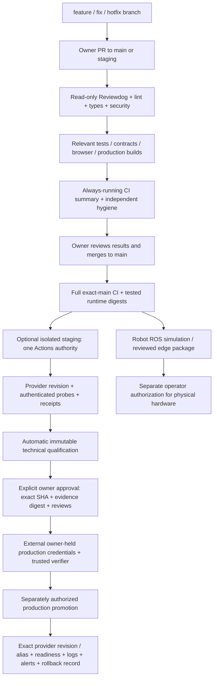

# CI/CD development workflow

| Repository | Frontend CI | Backend CI | Automated review | Staging | Qualification | Production release | Monitoring | Status |
| --- | --- | --- | --- | --- | --- | --- | --- | --- |
| Company Portal | Next.js lint/types/build/browser/contracts | Node tests/DB/contracts/image/startup | Read-only annotations + blocking scans | Scoped manual + opt-in auto; not deployed | Exact technical artifact + owner reviews | External owner handoff; blocked pending controls | Receipt/probes configured; live not run | Local implementation; owner activation pending |
| AI Platform | Next.js lint/types/build/browser/docs/TLS/contracts | Python tests/DB/pgvector/API/image/startup | Read-only annotations + blocking scans | Scoped manual + opt-in auto; not deployed | Exact technical artifact; hosted model/operations required | External owner handoff; blocked pending controls | Receipt/probes configured; live not run | Local implementation; owner activation pending |
| AI Robot | Static interface/proxy/types/browser/contracts | Cloud API/simulation/safety/image/startup | Read-only annotations + blocking scans | Scoped manual + opt-in auto; not deployed | Cloud-only technical artifact; hardware excluded | External owner handoff; physical separate | Manual staging monitor + receipt; live not run | Local implementation; durable storage/owner pending |

## Deployment architecture and trust boundary

These are workflow gates and an operating policy, not private-Free server-side branch
protection. GitHub Free cannot prevent a write-authorized user pushing directly to
private `main`. Such a push still runs full CI but is ineligible for production
qualification without an owner-merged PR. No independent reviewer is available;
automated annotations are CI evidence, never a second person's approval.

GitHub enforces token permissions, job dependencies/conditions, artifact integrity
metadata and workflow results for the unchanged configuration. Writers can replace
that configuration. Repository/environment labels and owner checks do not prevent a
writer changing a workflow to read repository secrets. Restrict write access to the
owner; keep production credentials in owner-controlled external custody; use separate
staging accounts/projects and identities. Stage secrets remain exposed to authorized
editable repository code, so isolation and provider scopes are essential.

External controls must disable Render auto-deploy/hooks and competing Vercel Git
Preview/production deployments, restrict production identity access and verify the
qualified revision/domain alias after promotion. Local `render-free-staging.yaml` and
Vercel configuration are prepared controls, not proof of deployed provider settings.
PR discipline, owner review, legal/content review and credential custody remain team
responsibilities. Existing remote workflows remain active until the owner authorizes
publishing these branches and merging the reviewed PRs.

## Automated review and dependency policy

Reviewdog v0.21.2 consumes existing ESLint, Ruff, mypy and TypeScript output without
rerunning the analyzer. It emits `github-annotations` to the Actions log with a
read-only token; no PR comment, Checks write token, reviewdog server or GitHub App is
required. Analyzer exit codes independently fail CI even if annotation succeeds.
Valid available PR base commits filter annotations to changed context; otherwise all
findings remain visible. Robot's existing JavaScript syntax checks stay in place;
it is a static interface/proxy, not a React application. Its actual directory is
`onesa-ai-robot-frontend` (package name `onesa-robot-interface`). Portal and Platform
frontends are Next.js; Portal backend is Node/TypeScript, the others Python/FastAPI.

Pinned official standalone binaries use archive **and binary** SHA256 locks checked
before execution on Linux AMD64 and local macOS ARM64. Reviewdog, Zizmor, Gitleaks and
actionlint have MIT licenses. No project license was introduced. Official Actions
retain immutable commit pins. The reusable security job is credential-free and uses
no `pull_request_target`, elevated PR token or analysis service.

| Tool | Role | Gate / limits |
| --- | --- | --- |
| Reviewdog | Read-only visible lint/type annotations | Original analyzer failure blocks; annotations are not approval |
| ESLint / Ruff / mypy / TypeScript | Existing applicable static checks | Fail independently; Ruff formatting and existing tests retained |
| actionlint 1.7.12 | Workflow schema/expression validation | Blocking; shellcheck disabled in this job, not claimed as a shell audit |
| Zizmor 1.30.1 | Offline Actions and Dependabot security | Medium/High/Critical blocking; Low advisory; reviewed trigger exceptions below |
| Gitleaks 8.30.1 | Published source secret detection | Blocking; ignored private data excluded, source symlinks rejected; matches redacted |
| Trivy 0.75.0, existing immutable image pin | Runtime image vulnerabilities and secrets | Existing HIGH/CRITICAL and secret gates retained, including unfixed vendor findings |
| npm audit / pip-audit | Existing package advisory checks | Existing severity thresholds retained; registry advisory queries do not upload source |
| Semgrep CE | Evaluated local scanning and telemetry controls | Not enabled in CI: no benchmarked project rule set yet; no hosted service/login/registry rules |

Semgrep CE is LGPL-2.1 per official repository metadata. A future evaluated local scan
must use owner-reviewed local rules, `semgrep scan --metrics=off --config=<local-rule>`
and no login/`semgrep ci`/hosted rule fetch. This audit evaluated its documented
capability; it did not run Semgrep or claim Semgrep coverage. The existing analyzers,
Trivy, secret/workflow checks remain the active baseline, avoiding an unmeasured extra
heavy scan on each PR. No external AI review bot was installed or source uploaded.

Copilot entitlement could not be read with the existing token. GitHub's documentation
says Copilot Free does not include repository Copilot Code Review; no paid capability
is assumed or required. An optional review of the diff through the user's already
authorized Codex session remains nonblocking; no Codex API subscription or runner
integration was added, and no CLI capability was claimed as verified.

Dependabot alerts are enabled, with **zero open alerts** in the readback. Automated
security-fix PRs were **disabled** in the before inventory and are now **enabled** on
all three remotes, verified by readback after the explicitly requested setting change. The new configuration schedules
monthly ecosystem updates, at most two version PRs per ecosystem, a seven-day version
cooldown, and compatible minor/patch version groups. Security updates are ungrouped
and have no version cooldown. Automatic security-fix PRs were enabled using the user-authorized setting; version
update schedules activate after the owner publishes and merges the local configuration. Bot PRs run the same read-only CI and
never automatically merge or deploy.

## Optimization and branch policy

Use `feature/*`, `fix/*` and `hotfix/*` PRs targeting `main` or `staging`; preserve
existing branches, including Portal's established `audit/portal-master-acceptance`.
Feature push CI duplication is removed: PR activity validates development changes;
`main`, `staging`, explicit dispatch and the established Portal acceptance branch run
full critical suites. No native restriction on pushes is asserted.

Superseded PR runs cancel; release-source runs and deployments do not cancel in
flight. npm download and pip caches key from committed lockfiles; no credentials,
private databases, models or deploy artifacts enter caches. `npm ci` and Python
`--require-hashes` remain the install policy. Platform Makefiles now also require
hashes. Deployment CLI's exact Vercel version remains pinned, but its global npm
install has no transitive lock; this is explicitly a Low advisory, not a hidden PASS.

The path classifier defaults to full CI on missing/invalid bases, failed diffs and
unknown/shared source. CI, infrastructure, contracts, scripts, auth, API routes,
middleware, security, migrations and configuration trigger all affected checks.
Recognized documentation PRs avoid application builds; static security and publication
hygiene still run, and Portal documentation validation runs in the security job.
Platform docs retain their actual browser/access checks. Recognized frontend-only PRs
retain browser/build/container checks. All release-source pushes run every critical
check regardless of paths and produce both runtime records.

The always-running `ci-summary` rejects missing classifications, failed/cancelled
jobs and unexpected skips. Release evidence additionally requires the actual named
critical jobs, including `pipeline-security / workflow-security`, and runtime artifact
digests. Verify that reusable job name in the first authorized remote run; a mismatch
blocks release rather than falling back to an absent check. Product-specific checks
remain independent; there is no new central repository or external dependency between
products. Dormant native/local workflows are retained until replacements have run
successfully remotely. Workflow count reduction is not claimed as a savings measure.

## Automatic qualification and intentional production authorization

`RELEASE_QUALIFICATION_JSON` is retired from deployment inputs. CI derives exact
repository/SHA/source-hash/runtime-image-digests, successful run IDs, authenticated
staging checks, provider revision/URL receipts and security state into JSON artifacts.
It verifies artifact archive digests and origin, parses bounded JSON only, never runs
artifact code, rejects another commit/fork/re-run, and rechecks current main and owner
PR provenance. JSON containing arbitrary PASS values is not authorization.

Automatic staging is off until `STAGING_AUTOMATION_ENABLED=true` is intentionally set.
It only accepts successful owner-triggered **push-to-main** CI from the same repository
and current main SHA, with repository visibility private. Portal/Platform additionally
require their established staging branch to point to that same SHA; no branch is moved
automatically. Before the first provider credential is exposed to a step, the
credential-free preflight checks actual CI/security/image records. Parallel hygiene
may still be incomplete at the trigger; preflight fails closed and the owner can
start a fresh manual staging dispatch after all checks finish. No unlimited retry.
This is an explicit safety tradeoff, not a guarantee of automatic success.

After the staging workflow succeeds for current main, `free-qualification.yml` derives
technical qualification automatically; owner manual dispatch is retained as fallback.
It receives no provider secrets. CODE_VERIFIED and STAGING_VERIFIED pass only from
actual verified results. Technical readiness evidence is recorded automatically;
OPERATIONS_VERIFIED stays BLOCKED while alert delivery, off-host restore/rollback or
operating limits have not been demonstrated. CONTENT_LEGAL_APPROVED always remains
BLOCKED in technical evidence. The audit cannot fabricate those missing results to
satisfy an automation label. Hosted AI inference is not approved by local mock/Ollama.

The owner initiates `free-authorization.yml` on main, chooses **approve** (default
**revoke**), supplies the exact qualification run/digest and an open owner-authored
issue binding SHA/digest to OPERATIONS_APPROVED, CONTENT_LEGAL_APPROVED and
EXTERNAL_PRODUCTION_CONTROLS_VERIFIED. The authorization artifact records operator,
time, exact candidate, source digest, target Production and review issue digest.
Latest pending/failed/revoked authorization, issue changes/closure, stale evidence,
main movement, failed CI or mismatched artifacts invalidate previous authorization.
This is solo-owner authorization, not two-person approval.

Run `scripts/release/free_gate.py verify` from an independently owner-reviewed,
immutable clean checkout outside repository Actions with owner GitHub authentication.
It returns AUTHORIZED_EXTERNAL_HANDOFF only after live provenance/digest checks; it
never deploys. Production credentials must never be supplied to that editable CI.
Private credential-bearing native production build/deploy/repair/inspection/docs jobs
remain excluded. Production promotion still requires a separately authorized external
provider executor and post-deploy receipt. This task did not create or provision a
trusted external executor and does not claim a complete live private-Free production
service. The retained native protected-main path is only usable where support and
protection are verified; it is not a fallback to bypass a private-Free gate.

## Reviewed findings and workflow-run exception

Zizmor's generic HIGH `dangerous-triggers` rule is locally annotated only on the two
reviewed controllers `release-staging.yml` and `free-qualification.yml`. No HIGH or
CRITICAL application/image finding is suppressed. These trigger exceptions have
specific evidence: fixed owner/repository checks, owner-triggering actor, upstream
push/main/success and exact current SHA, automatic staging default-off/private-only,
full CI/image preflight before staging-only credentials, no production credentials,
no artifact execution, and credential-free qualification. Regression tests reject
foreign owners, forks, wrong SHAs/events/failures and changed branch pointers, and
check the opt-in/triggers/credential ordering. The staged source checkout is the exact
current main commit, not an upstream artifact. Re-runs are rejected.

The generic trigger finding was reviewed as not reaching the standard privileged
untrusted-PR/artifact attack path under these constraints. It is still a trust-sensitive
exception, **not** proof against a repository writer changing the controller or
stealing scoped staging credentials. Do not remove provenance checks or put production
keys into these workflows. The old native qualification trigger and Robot production
monitor trigger were made manual; Robot monitor now uses staging keys only. Remaining
Low advisories include the exact-version global Vercel install and owner-conditioned
self-repository comparison. Their presence is disclosed below.

## Monitoring, model and Robot limits

Staging deployment helpers poll actual completion with bounded attempts, check provider
identity/revision, authenticated readiness, real API workflows and frontend/backend
integration and retain sanitized receipts. No deployment was triggered during this
audit. Full runtime logs/error-rate/alert delivery and provider identity readback need
the separately scoped provider credentials, which are unavailable locally and absent
from repository staging secret inventories. No hosted/model/sensor/actuator PASS is
inferred from a synthetic fixture, local successful build or process liveness.

Platform acceptance keeps real-hosted streaming/cancellation/context/embeddings/vector
storage/knowledge/agent/usage-limit/recovery evidence separate from mock/local-model
tests. Robot frontend and cloud backend have separate images, CI and Render/Vercel
staging identities. ROS interfaces use an isolated pinned Jazzy container; simulation,
edge packages/operator distribution and physical robot deployment remain separate.
A passing simulator or message contract does not qualify physical hardware. Persistent
Robot SQLite/cloud storage still requires a verified durable approved target; do not
claim a free Render web service provides a persistent disk or silently provision one.

For rollback, retain previous exact provider deployment IDs/image digests and Vercel
aliases privately. Revalidate health before switching to a known compatible revision;
match application and schema compatibility, preserve databases/volumes/model assets,
and obtain separate approval for destructive or incompatible migrations. Do not
reverse migrations automatically or run an open-ended repair loop. Existing local
rollback baselines remain unchanged. No continuous observation after this session is
promised; owner-configured alert delivery remains a production prerequisite.

## Owner activation actions

1. Resolve the discrepancy: all remote repositories are public, while the requested
   policy is private/Free. Confirm subscription and protection capabilities in billing
   and repository settings. No visibility change, upgrade or paid capacity is authorized.
2. Review and authorize publishing these feature branches and opening PRs; merge only
   after the actual new remote CI is green. Reconcile remote job names with evidence
   policy; preserve all critical gates and validate on a failing feature PR.
3. Set default Actions token read-only and disable Actions PR approval where possible;
   restrict write access to the owner. Dependabot automatic security-fix PRs are
   already enabled and verified; the other settings were audited but not changed.
4. Move/rotate existing production repository secrets into external owner custody and
   remove them from editable repository Actions after confirming the replacement.
   GitHub repository secrets are Settings > Secrets and variables > Actions; a private
   Free environment label does not add an unavailable required-reviewer barrier.
5. Create separately scoped staging provider identities/accounts/projects, then add
   the STAGING_* names listed in the repository pipeline report as repository Actions secrets and nonsensitive
   target metadata as variables. Tokens come from Render Account Settings/API Keys
   and Vercel Account Settings/Tokens; project/service identifiers come from the actual
   staging resources. Never paste tokens into issues or chat. Provider application/DB
   runtime secrets belong in that provider's private environment, not browser variables.
6. Read back actual Vercel project/root/backend target/Preview protection/domain and
   Render repo/root/build/start/Dockerfile/branch/health/DB/storage/workers/auto-deploy.
   Disable competing Git auto-deploy/hooks in both staging and production with owner
   authorization. Do not enable the staging switch based only on files in Git.
7. Perform the authorized manual isolated staging run first, verify receipts/probes
   and both frontend/backend revisions, align preserved staging branch with main by
   reviewed PR/merge policy, then intentionally opt in to automatic staging if desired.
   Repeat monitoring/negative checks on staging, never destructive production tests.
8. Demonstrate missing operational evidence, complete legal/content review, arrange
   a trusted external production executor with owner-held scoped credentials and a
   verified rollback/receipt plan, then issue exact-digest manual authorization.
   Robot physical deployment has its own operator/safety/licensing authorization.
9. Check owner-level Actions billing minutes/storage, enable budget stop controls and
   usage alerts without enabling paid execution. Review oversized historical artifacts
   before any authorized deletion; no artifacts/caches were deleted here.

## Sources

- [Reviewdog reporters and integration](https://github.com/reviewdog/reviewdog)
- [Zizmor offline usage](https://docs.zizmor.sh/usage/)
- [GitHub included usage](https://docs.github.com/en/billing/reference/product-usage-included)
- [GitHub Actions limits](https://docs.github.com/en/actions/reference/limits)
- [Dependabot options and version-only cooldown](https://docs.github.com/en/code-security/reference/supply-chain-security/dependabot-options-reference)
- [Copilot Code Review availability](https://docs.github.com/en/copilot/concepts/agents/code-review)
- [Semgrep metrics and local rule usage](https://docs.semgrep.dev/metrics)
