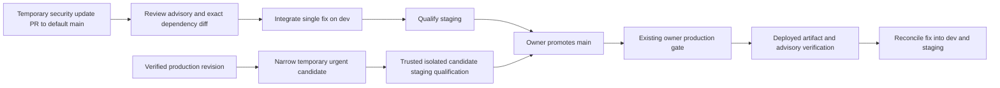

# Deployment and independent releases

## Oracle backend migration — owner authorized 2026-10-16

The owner now authorizes moving the existing staging and production APIs from Render
to the existing Oracle worker VM. This supersedes the backend-deployment pause for
this migration only. Keep qualification active; the Render billing hold itself remains.
Preserve the existing worker/scanner services, BaSyx, databases, credentials, accounts,
stored content, Robot history and physical-controller restrictions. Frontends stay on
Vercel; migrate only their server-side backend origin when the new target qualifies.

`compose.oracle-backend.yaml` defines independent staging/production API profiles.
Images must be ARM64, scanned, source-labelled and pinned by immutable image ID.
Each environment has separate networks, runtime files and (where used) storage volumes.
Ports bind only to loopback; no public API/container/database/SSH port is opened.
The existing PC-to-VM Tailscale SSH route remains an administrative connection.
Use an explicitly configured Cloudflare HTTPS tunnel for API ingress, retaining
application authentication/CSRF/ownership checks and existing Access/WAF protections.
No wildcard ingress or privileged crawler/session bypass is permitted.

Keep matching private runtime values in root-owned mode-600 files under
`/etc/onesa/backends/`; never copy them into Git or Actions. Preserve each environment's
original database, origin, key and inference/storage settings. Build from credential-free
Git archives off the VM and record exact backend tree, source commit, image ID,
archive digest and scan results in existing restricted evidence. The image map uses
`ORACLE_STAGING_IMAGE`, `ORACLE_PRODUCTION_IMAGE` and their corresponding `_COMMIT`
variables; both image values must be immutable `sha256:` IDs already loaded on the VM.

Run isolated config checks first, then deploy only the named staging service with
`docker compose --env-file <private-image-map> -f compose.oracle-backend.yaml
--profile staging up -d --no-build staging` (one command). Record healthy readiness,
private anonymous denial, authenticated workflows and measured host/container capacity.
An unavailable service or uncertain Robot journal lease stops activation; never repair
history through SQL or force an active lease. Reuse valid exact-source application
qualification and perform target-specific migration acceptance; local/config tests
alone are not hosted acceptance. Do not conceal a known application failure as PASS.

Only after the applicable staging/source/preservation gates pass, run the corresponding
explicit `--profile production ... production` command, then change the matching
frontend backend-origin binding and verify the deployed frontend revision and API.
Do not use `compose down`, restart workers, run migrations automatically, delete old
services, rotate credentials, provision paid capacity or change unrelated domains.
Keep the prior frontend/backend configuration and images for rollback. Render is
currently suspended: restoring its old URL is configuration rollback, not recovery of
service availability. On failure stop promotion and retain the actual partial state.

Staging has lower CPU shares/limits than production. Observe memory/OOM/error counters
and latency alongside the existing scanner and workers; a short idle sample does not
qualify peak load. Existing backups/monitoring remain active. Public documentation must
not publish the private runtime files, host inventory, source layouts or audit records.


## Render capacity hold — local maintenance, 2026-10-16

The owner confirms Render credits are exhausted and Render deployments remain paused.
Do not dispatch staging qualification that deploys to Render or request a Render recovery build,
resume a suspended service, change billing or provision paid capacity during this hold.
Continue non-deploying qualification and the authorized Oracle migration above. Preserve the
existing source-bound hosted results; they do not establish current API availability.
A restored Render budget is required before another Render build. Oracle migration
acceptance follows the source, staging, preservation and owner controls above.

The maintained deployment script now requires `suspended: not_suspended` and an
explicit empty `suspenders` list before creation and again when observing `live`.
Missing, malformed, contradictory or suspended service metadata blocks success;
a deployment's `live` status alone is insufficient. This check does not resume,
cancel or recreate a deployment. No availability failure is authentication evidence.
The staging producer also applies this check before reading runtime configuration
or requesting deployment. Offline regression: `python3 -m unittest discover -s
scripts/release -p test_render_availability.py` (one command).
These changes are prepared on development source; no new hosted release is claimed.
Rollback: revert only the reviewed maintenance commit, retaining existing receipts
and the owner-directed deployment pause.

## Branch policy and dependency releases

Three permanent branches: dev, staging, main. Temporary Dependabot security-update
and necessary narrow security-release branches are permitted. Normal promotion remains
dev → staging → main. Security PRs target default main and receive isolated credential-free
CI; incorporate their reviewed change once through the normal path. Urgent candidates
start from the verified production source, exclude unfinished dev work and require
trusted exact-candidate staging qualification before the existing owner-controlled
production gate, followed by reconciliation into dev/staging. Temporary refs do not grant
staging or production credentials. See the existing
[dependency-maintenance procedure](BUILD_AND_TEST.md#dependency-maintenance-and-continuing-detection).



## Owner-authorized pre-launch operation — 2026-10-15

The owner explicitly requested deferring the Company API's global `409 LEGAL_GATE`
until launch so existing features can operate during pre-launch development.
Set `PUBLICATION_STAGE=prelaunch` only on the authorized API and qualified worker.
The validated default is `launch`; other values fail configuration validation.
`publication_enabled` reports operational access separately from `release_ready`,
which continues to report the actual legal prerequisites without inventing approval.
Protected administration shows the active mode. No legal setting, governance approval,
retention rule or processor record is changed by this mode.

The exception covers existing published content and categories, enquiries, recruitment,
and explicitly approved, public, clean files. Draft/future content stays private.
Exact-version editorial/media review, publisher roles, authentication/MFA, CSRF,
object access, malware quarantine, rate limits and immutable audit records still apply.
Scheduled content uses the same mode and still needs exact-version editorial review.
Business-data expiry remains disabled; the exception does not enable retention deletion.
The footer routes general enquiries to the localized Contact form; legal and privacy
pages retain the previously approved company/contact particulars.

Before launch, change API and worker to `PUBLICATION_STAGE=launch`, verify actual
company facts, notices and legal/processing decisions through the established review,
and qualify the resulting public workflow. Do not turn legal settings true simply to
clear a dashboard. The owner also explicitly authorized public production indexing. Enable
`PUBLIC_RELEASE_ENABLED=true` on the qualified production Company frontend. Public
metadata and the canonical sitemap follow `publication_enabled`; actual legal readiness
is still reported separately. The sitemap contains only maintained public routes and
published, due content. Portal administration, API/private resources, previews and
staging retain their access and indexing boundaries; unrelated bot policies are unchanged.
Rollback the exception by restoring `launch` on both services, verifying public requests
return the existing hold if prerequisites remain incomplete, and retaining all records.
Use exact-source staging, CI and the owner-controlled release path; preserve credentials,
data and the currently qualified worker until its replacement passes cutover checks.

## Verified crawler access and publication scope — 2026-10-14

Crawling follows the existing publication approval and access boundaries. A deployed
website, an accessible static file or a declared public route is not approval to
publish drafts. `robots.txt` and `noindex` guide crawlers; backend authorization and
Cloudflare Access protect private resources independently.

| Production surface | Approved crawl scope and current constraint |
| --- | --- |
| Company `onesa.eu` | The earlier 14 October readback had publication closed. The owner has now authorized pre-launch public production indexing through the procedure above. Retain exact-version editorial approval; this does not fabricate legal approval. Use canonical EN `/`, DE `/de`, approved section/detail routes and their approved media; omit `/en` aliases, query variants, admin/API routes and unpublished CMS/private files. |
| Public Docs `docs.onesa.eu` | Public production documentation and its classified assets permit crawling. The existing `docs/documentation-policy.json` allowlist governs public pages, generated indexes, diagrams and PDFs; arbitrary source or generated files are not public by default. Preview deployments remain outside the public crawl scope and protected by their existing SSO/noindex policy. A qualified staging revision is not proof that production has changed. |
| Robot `robot.onesa.eu` | The public, script-free landing page and its public presentation assets permit crawling. Retain `/console` and `/api/` exclusions, console noindex and backend operator authorization for status, tasks, telemetry, history and controls. |
| AI workspace `platform.onesa.eu` | The sign-in/workspace surface is private and has noindex metadata. Its current `/robots.txt` returns 404, which does not authorize indexing conversations, Knowledge documents, Agents, Travel or authentication/API routes. Public AI discovery belongs in the approved Company/Docs descriptions. |
| Portal administration and engineering Docs | No crawler session, token or Access bypass. Keep governance records/PDFs, applications, uploads, private search/schema/manual/diagram indexes and all engineering deployment origins protected. |

Company enforcement is in `src/proxy.ts`, `src/lib/publication.ts` and
`src/app/sitemap.ts` in the frontend, plus backend `src/services/workflows.ts` and
exact-revision editorial/media approval. The existing restricted release evidence
does not infer legal/content approval. Determine any missing approval from the
protected owner workflow before changing publication flags; do not open the gate
to resolve a crawler request.

Identify DuckDuckBot using its actual connection source against the current
[official DuckDuckBot address inventory](https://duckduckgo.com/duckduckbot.json)
and the available [Cloudflare verified-bot identification](https://developers.cloudflare.com/bots/concepts/bot/verified-bots/).
The 14 October read retained 486 unique IPv4 `/32` entries. Re-read and validate the
official inventory before a future rule change; do not trust the user agent or
client-supplied `X-Forwarded-For`, `CF-Connecting-IP` or bot headers. The anonymous
and spoofed-header GET audit tests denial only; it cannot prove real bot access.
Use authenticated provider metadata only in the existing owner-held custody;
never send crawler credentials or create authenticated crawler sessions.

The recorded Cloudflare reads changed no settings: Company and public Docs are
proxied; Platform and Robot are DNS-only, so their HTTP traffic is outside this
zone's Cloudflare event dataset. Bot Fight Mode was disabled in the readback.
Unavailable rule endpoints are not proof that every protection is absent. The
verified 24-hour security/traffic queries ending 14 October at 15:06:31 UTC returned
no DuckDuckBot matches; adaptive sampling and dataset limits prevent a universal
access claim. No actual DuckDuckBot false positive was established, so no allow or
skip rule was added. Preserve DuckAssistBot and every unrelated bot policy, WAF,
rate limit, SSO, authorization and private-cache control.

Use the existing Cloudflare dashboard Security Events and traffic views to review
actual source-qualified DuckDuckBot requests on proxied public hosts. Record the
window, sampling/limit status, host, sanitized route class, action and rule ID in
the existing restricted audit location. Monitor backend authorization and private
resource denials separately; a timeout, 404, 5xx or an unexpected 200 is not a
verified authentication-denial result. Save sanitized per-request results as they
finish, without private response bodies, cookies or tokens.

Any future crawler correction must be limited to approved production paths/assets,
follow dev → staging → main and retain exact-source qualification and owner release
control. Check robots, sitemap, canonical/noindex metadata and anonymous/spoofed
private-resource denial before and after deployment. If a more specific bot group
is introduced, repeat its private-path exclusions because wildcard rules are not
inherited by that group. Preserve the existing Facebook sharing exception. Roll
back a defective source change through the same release path to the retained
qualified revision, restoring its exact robots/sitemap/metadata policy; keep all
publication approvals, credentials and private controls intact. A future provider
rule would need separate scoped authority, prior-configuration evidence and exact
rule restoration/removal on rollback; this record authorizes no provider change.

References: existing AI restricted evidence `system-design-v2-duckduckbot-robots-readback.json`
and owner readbacks `duckduckbot-official-ip-source-20261014.json`,
`duckduckbot-zone-controls-readback-20261014.json` and
`duckduckbot-native-security-traffic-qualified-readback-20261014.json` under the
existing release/runtime audit locations; [robots matching rules](https://www.rfc-editor.org/rfc/rfc9309#section-2.2.2).

## Oracle Always Free worker VM through OCI CLI — 2026-10-12

The owner selected the local OCI CLI for provisioning `onesa-portal-worker` after
Cloud Shell browser control was unavailable. The standalone
[provisioning script](../../infra/oracle/provision-worker.py) supports both local
CLI sessions and Cloud Shell. Authenticate into the ignored private directory,
preserving the existing `~/.oci/config`:

```sh
mkdir -p private/oracle/session
chmod 700 private/oracle private/oracle/session
oci session authenticate --region eu-frankfurt-1 --profile-name onesa-portal-worker --config-location "$PWD/private/oracle/config" --token-location "$PWD/private/oracle/session"
export OCI_CLI_CONFIG_FILE="$PWD/private/oracle/config"
export OCI_CLI_PROFILE=onesa-portal-worker
export OCI_CLI_AUTH=security_token
python3 infra/oracle/provision-worker.py --ssh-cidr YOUR_PUBLIC_IPV4/32 --output-dir private/oracle/worker
python3 infra/oracle/provision-worker.py --apply --ssh-cidr YOUR_PUBLIC_IPV4/32 --output-dir private/oracle/worker
```

The final command creates resources only after all checks pass. Local keys and the
instance receipt remain in `private/oracle/worker/`; the existing default CLI
profile is preserved. Treat the private session/key files as credentials, never
source or upload artifacts. Sign-in is browser-based and must be completed by the
account owner.

For the Cloud Shell alternative, upload the standalone provisioning script
using the Cloud Shell menu's **Upload** action. It uses Cloud Shell's existing
authenticated OCI CLI, including its config-file/profile/auth environment variables;
no Mac CLI session renewal, API key or token upload is needed. Select Frankfurt
before opening Cloud Shell; the script refuses provisioning unless the chosen region
is the tenancy's home region.

Run these commands from the directory containing the uploaded file:

```sh
python3 provision-worker.py
python3 provision-worker.py --apply
```

The first command only reads inventory and reports a plan. The second rechecks
inventory, asks for **your Mac's public IPv4 address**, generates a dedicated SSH
key if none was supplied, then creates the VM and its isolated network. Find the
Mac address with `curl -4 https://api.ipify.org` in **Mac Terminal**, not in Cloud
Shell. Alternatively, use `--ssh-cidr YOUR_PUBLIC_IPV4/32` and
`--ssh-public-key-file ./your-public-key.pub` to supply an existing public key.
Never upload that key's private half. `--compartment-id` selects an existing active
compartment; the default is the tenancy root. No IAM policies are created.

The fixed VM is `VM.Standard.A1.Flex`, 1 OCPU, 6 GB RAM, a 50 GB Balanced boot
volume, and the latest available official Ubuntu 24.04 ARM64 platform image
(Ubuntu 22.04 ARM64 fallback). The worker subnet uses only a dedicated security
list: TCP 22 from the supplied public `/32`, plus ICMP fragmentation-needed for
path MTU discovery. Stateful outbound internet traffic is permitted. HTTP, HTTPS
and ClamAV ports have no inbound rules. The VCN's default security list is unused.
Cloud-init disables password/root SSH and enables Ubuntu security-update tooling;
it does not install or start the Portal worker.

The script reads instances in all active compartments and subscribed ready regions,
and all home-region boot/block volumes, including stopped instances and unattached
volumes. It bounds the resulting allocation to 2 A1 OCPUs, 12 GB RAM and 200 GB
storage. It also reads current-month A1 CPU/memory usage and checks a projection
through month end, allowing 48 hours for delayed reporting on existing allocation.
Inaccessible inventory, unknown A1 usage units/SKUs, an existing same-name instance,
or a conflicting network resource stop the operation. Usage reporting can lag;
these bounds do not replace checking the tenancy's Always Free eligibility and
actual current-month usage in the Console. Do not upgrade the account or use paid
resources to resolve a capacity/permission failure.

It tries each home-region availability domain once only after explicit
`Out of host capacity`; other errors/timeouts stop without automatic relaunch.
Tagged network resources and the key remain for a later retry. Existing resources
are reused only when their configuration matches; there is no deletion, takeover,
SSH-rule widening or paid-shape fallback. A created instance immediately gets a
receipt at `~/onesa-portal-worker/instance.json`, with verified configuration/IP
added only after successful running-state, shape, volume, VNIC and network readback.
The receipt's OCID can be used to inspect an instance if later verification fails.

If a key was generated, download
`onesa-portal-worker/onesa-portal-worker.pem` through **Cloud Shell → Download** and
retain it securely. On the Mac, using the IP from the verified receipt:

```sh
chmod 600 ~/Downloads/onesa-portal-worker.pem
ssh -i ~/Downloads/onesa-portal-worker.pem ubuntu@ORACLE_PUBLIC_IP
sudo cloud-init status --wait
```

The existing `compose.oracle-staging.yaml` is a separate, locally prepared
outbound-only ARM64 worker/ClamAV deployment. The worker polls the existing
PostgreSQL queue with authenticated outbound database access and retrieves private
S3 objects; it does not expose a public scanning API. Privately supply the approved
isolated staging database/storage/mail bindings and existing encryption key before
installation. Keep publication disabled. ClamAV signature updates, clean/rejected
scan checks, job consumption, mail delivery, restart/health checks and capacity
testing remain required; creating a VM does not qualify these integrations.

Status on 2026-10-12: separate local browser authentication succeeded, the home
region was verified as Frankfurt, and authenticated instance/volume/monthly usage
inventory completed. The owner explicitly authorized resizing `basyx-server` from
2 OCPUs/12 GB to 1 OCPU/6 GB, then creating the separate worker. BaSyx returned to
RUNNING at the approved size; its instance/image identity, IP addresses, VNICs,
boot-volume attachment, tags and metadata were read back unchanged. Its resize
receipt is retained in ignored `private/oracle/basyx-resize.json`.

`onesa-portal-worker` was created in Frankfurt AD-2 after AD-1 reported out of host
capacity: official Ubuntu 24.04 ARM64, A1 Flex, 1 OCPU, 6 GB RAM and 50 GB Balanced
boot volume. The running state, exact shape/volume, public VNIC, dedicated network
and restricted SSH rules passed provider readback. Both VMs together allocate
2 OCPUs/12 GB RAM and 100 GB boot storage. The real OCID, assigned IP, SSH source
CIDR and key path are retained in ignored `private/oracle/worker/instance.json`;
the generated local private key is `private/oracle/worker/onesa-portal-worker.pem`
with permissions 0600. Known-host verification uses `private/oracle/known_hosts`.
Do not commit these private artifacts.

The first launch attempt was rejected locally because the CLI requires a top-level
`subnetId`; no worker existed before the corrected retry. The first-boot SSH reload
failed because Ubuntu 24.04 uses socket activation. The source bootstrap now
validates sshd and uses `try-reload-or-restart`; the VM's generated bootstrap script
was repaired in place. Oracle's reserved launch `user_data` is immutable and was
preserved. After an ordinary reboot, cloud-init reports `done`, SSH succeeds using
the same known host key, ARM64/1 CPU/6 GB resources are confirmed, the security-update
timer is active, and root/password/keyboard-interactive logins are disabled. Final
SSH/cloud-init/reboot verification is recorded in the private instance receipt.
Portal worker/ClamAV deployment and hosted integration acceptance
remain pending; VM creation does not close the business release gates.

Offline validation:

```sh
python3 -m unittest discover -s infra/oracle -p 'test_*.py' -v
python3 scripts/repository_hygiene.py
```

Sources: [Cloud Shell authentication and file transfer](https://docs.oracle.com/en-us/iaas/Content/API/Concepts/devcloudshellgettingstarted.htm),
[current Always Free resources](https://docs.oracle.com/en-us/iaas/Content/FreeTier/freetier_topic-Always_Free_Resources.htm),
[official Ubuntu 24.04 images](https://docs.oracle.com/en-us/iaas/images/ubuntu-2404/index.htm),
[OCI Usage API](https://docs.oracle.com/en-us/iaas/tools/oci-cli/latest/oci_cli_docs/cmdref/usage-api/usage-summary/request-summarized-usages.html).

## Reviewed staging path — 2026-10-12

After dev PR and exact merged staging CI pass, use the already registered owner workflow: `gh workflow run deploy.yml --ref staging -f target=staging -f fixture_mode=temporary`. Staging-only credentials and the existing approved synthetic scope/project JSON are required. The fixture helper creates two random identities through the verified restricted staging application role, keeps credentials only in a 0600 runner file, then disables those exact identities and revokes sessions on cleanup. Provided fixtures remain available with `fixture_mode=provided`; production accounts are never created by this helper.

Vercel native Git owns the protected staging frontend Preview. The release workflow waits for and verifies its exact SHA/project/ref instead of deploying a second frontend. Actions owns the manually deployed exact-source backend. Actual API/auth/workflow/storage/browser acceptance remains mandatory; FAIL/BLOCKED receipts cannot qualify. No migration, production approval, visibility or paid change is implied.

The staging routing operator saves only branch-specific server bindings and verifies production metadata unchanged. Private proxy readback uses Vercel's individual-variable endpoint and requires `decrypted: true` plus exact variable identity and staging scope; list ciphertext is never treated as the credential. An unverified readback blocks qualification even when the provider accepted the write.

Hosted scanner troubleshooting uses only fixed failure codes: `STORAGE_QUARANTINE`, `STORAGE_SCAN_REJECTED`, or `STORAGE_SCAN_STATE`. Acceptance requires `scan_status=clean` before download. Check the read-only API/worker `CLAMAV_HOST` and mail key-presence inventory privately, then verify the approved scanner endpoint is reachable from the actual runtime. A present host or successful upload is not a clean scan or delivered mail. Keep quarantined objects private and use an approved executor; do not substitute a web service or fake scanner result.

> Current private-Free release policy: [safeguards and external owner authorization](../development/PRIVATE_FREE_SAFEGUARDS.md). Legacy JSON approval is retired; native protection requirements below apply only to a verified supported configuration.

The frontend and backend have separate Docker build contexts and versioned images.
Build either image using the build guide, label it with the reviewed source revision,
and release only the selected application when API compatibility allows. Worker and
migration jobs use the backend image. Do not bundle sibling repositories.

Before production: approve domain/content/ownership, provision TLS ingress, a private
PostgreSQL database and encrypted access-controlled storage, generate runtime secrets,
validate email/storage/antivirus integrations and verify backup restoration. Apply
migrations once through a controlled job before API rollout. Retain the old image and
use backward-compatible migrations so rollback does not require deleting data.

Reference stack: `compose.production.yaml`, proxy settings under `infra/proxy`, and
`scripts/verify-production-gates.mjs`. Supply a private `.env.production` via
`PORTAL_ENV_FILE`, `POSTGRES_PASSWORD`, approved `PORTAL_DOMAIN`, `BACKEND_IMAGE` and
`FRONTEND_IMAGE`. Validate configuration with `docker compose --env-file .env.production
-f compose.production.yaml config --quiet` (single shell command). Do not print expanded
configuration containing secrets. Only deploy after explicit authorization.

For separate hosts, route `/api/v1/*` from the frontend's public origin to the backend
through TLS ingress, including cookies, Origin and CSRF headers. Configure the frontend
server's `BACKEND_URL` and backend `PUBLIC_ORIGIN` consistently. Keep database and storage
private. Health checks: frontend `/en`; backend `/api/v1/ready`. Run smoke and isolated
browser checks before traffic promotion. Monitor authentication/errors/worker queues.

`release.yml` selects and builds one application container artifact manually; it does not publish or
deploy. Configure production reviewers in GitHub and verify the selected commit passed
`verify` and `publication-hygiene` before manually dispatching it; the workflow enforces these exact-revision checks. Artifacts must contain
images/approved synthetic evidence only, never corporate PDFs, uploads or secrets.


### Release-candidate protocol migration (2026-10-10)

Generated clients are derived from actual route schemas; accepted release-baseline.json is unchanged. New bounded upload/chunk/finalization/cancel routes preserve agreed size capabilities and authorize owner/expiry/quota/type/checksum at the backend. Large downloads use reauthorized bounded chunks; older whole-file clients must migrate before hosted large-file acceptance. Portal user mutations require current password plus fresh MFA/recovery proof; older clients receive403 STEP_UP_REQUIRED, not a silent fallback. Public provenance/reviewer fields stay private. This intentional compatibility policy requires coordinated client/version approval. AI optional invitation input and strictly refined response schemas are directionally checked. Durable recovery uses one-use tokens and queued/provider-accepted truthfulness; hosted mail is not verified. Consult generated contracts and restricted release ledger for exact paths/tests; no public rollout occurred.


Owner free-only direction supersedes paid provisioning examples. Follow
[FREE_STAGING_SETUP](FREE_STAGING_SETUP.md) and staging.env.example; no paid
Blueprint/application or production release is approved by an example.

### Neon S3 environment and Render build troubleshooting — 2026-10-10

API and worker need the same private `S3_BUCKET` (owner-selected `s3-bucket`).
`S3_ENDPOINT` and `S3_REGION` remain canonical; the backend also accepts
`AWS_ENDPOINT_URL_S3` and `AWS_REGION` when the canonical values are absent.
The SDK reads `AWS_ACCESS_KEY_ID` and `AWS_SECRET_ACCESS_KEY` privately. An
endpoint alone does not identify a bucket. Replace exposed credentials directly
in Neon/Render; do not place their values in source, frontend bundles or reports.

Use root directory `onesa-company-portal-backend`, Dockerfile `./Dockerfile`,
and Docker context `.`. The seven migrations are tracked in that backend root.
A missing-migrations COPY error requires verifying the actual service, selected
commit and build context; do not remove the COPY or skip schema checks. The
API starts with `node dist/src/server.js`; a real background worker uses
`node dist/src/jobs/worker.js`, not a web service that requires an HTTP port.
Do not create a paid worker or hide missing worker functionality to satisfy the
owner's free-only requirement. Both roles require verified shared persistent
storage. Successful compilation does not prove bucket access, credential
rotation, migrations, worker operation or production release qualification.

### Portal DATABASE_ROLE remediation

A production readiness response with code `DATABASE_ROLE` means the application
connection has administrative, ownership or migration-write privileges. Preserve
this check. Create a dedicated runtime identity instead of disabling the check or
changing NODE_ENV. The existing owner-selected Portal Neon database is `neondb`
on the established `ep-dark-boat-b91lg22g` branch; its default database name does
not make it the AI database. The operator repair verifies that branch, all seven
Portal migration checksums and the complete schema inventory before any grants.

Rotate any exposed Portal owner password in Neon first. Save the fresh direct
(pooling OFF) TLS connection URL as GitHub Actions repository secret
`PORTAL_MIGRATION_DATABASE_URL` in `DruHustle/onesa-company-portal`. Never paste
its value in chat, documentation, frontend settings or workflow inputs.

Dispatch `Repair existing hosting configuration` on `fix/render-runtime-repair`:
first choose `inspect-role`, then `repair-role` after that revision's CI and hygiene
pass. The repair creates `onesa_portal_app` only when absent, privately generates its
password, preserves existing data, grants application CRUD/sequence privileges and
read-only migration access, checks that runtime permissions are restricted, and
saves the pooled URL only on the verified Portal API service. An existing role with
an unknown password is preserved and requires private operator configuration.
The misidentified RENDER_WORKER_SERVICE_ID is not updated or deployed.

Saving configuration is not hosted acceptance. Render restart reuses the existing
environment values; it is not a substitute for applying new settings. A new deploy
must follow the existing release qualification and exact-revision CI gates. After
that authorized deploy, verify actual JSON responses: `/api/v1/health` 200,
`/api/v1/ready` 200 and unauthenticated `/api/v1/auth/me` 401. Render's loading HTML
may return HTTP 200; do not classify it as application readiness.

References: [Render Docker commands](https://render.com/docs/docker),
[Render deployment and restart behavior](https://render.com/docs/deploys).


### Public rendering and publication status

The owner-approved public website renders its factual pages and product information
without fetching the company approval-status endpoint. A cold or unavailable API must
not replace public navigation with a release-approval screen or change indexing.
`PUBLIC_RELEASE_ENABLED=true` identifies the approved public production deployment;
protected Preview deployments retain their separate environment label and noindex.
CMS requests still use the published-only public endpoints, bounded optional reads
and their existing 404/error behavior. Backend editorial approval, administrator sessions,
private files and write authorization remain independent. The owner’s pre-launch legal
deferral remains a deferral; frontend availability does not create approval records.

### Provider billing suspension — observed 2026-10-15

A Render deployment record can remain `live` while its service is suspended. Before
a production handoff, read the actual service suspension state and suspenders as well
as the exact deployment/source; a live deployment alone does not prove availability.
The Company, AI and Robot Free production services reported billing suspension at
19:16 UTC. A provider suspension page/503 is neither readiness nor authentication
denial. The precise billing limit still needs the account Billing notice; do not
infer a quota from earlier usage figures, restart repeatedly or change plans.
Preserve completed UI acceptance separately. After the provider hold is resolved,
establish actual readiness and complete only the outstanding read-only API checks.
The UI publication does not certify full API availability or change legal records.
