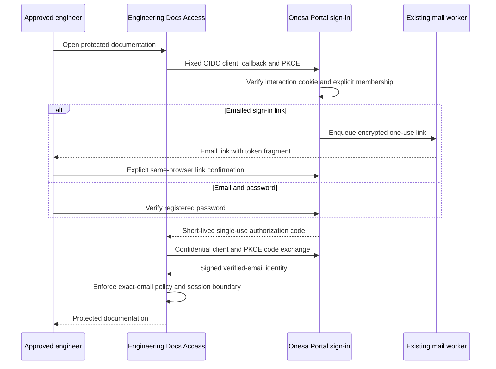

# Engineering Docs sign-in through Onesa Portal

Classification: INTERNAL. Owner: Onesa engineering owner. Status: prepared, not
activated. Source: the Portal identity module and additive migrations 010/011. Last
source verification: 2026-10-17; hosted activation and owner sign-in remain separate.

Engineers sign in through Onesa Portal using either an emailed sign-in link or
their registered email and password. First-time users register and verify their
email; new requests remain pending owner approval. The two owner-confirmed existing
addresses retain their decisions through the reviewed private preapproval configuration,
without automatic approval of the entire Onesa domain. Existing Portal administration
retains its passwords, roles and MFA; an emailed admin link replaces only the password
step and still requires the existing authenticator or recovery code. A Docs identity
never creates a Portal administrator.
Cloudflare Access continues protecting every Engineering Docs hostname and asset.
This identity provider is limited to that documentation application; it does not
merge Company, AI or Robot accounts.

## Registration and owner approval

First-time users select Company administration or Engineering Docs at `/access/register`.
The form asks only for their email and requested access. The full normalized email
identifies the request and is shown to the owner; no personal name is collected.
For compatibility with the deployed API, the frontend derives its required display
label from the email, bounded to 120 characters. This label is never an identity or
authorization key; the complete email remains unchanged even when it is longer.
Existing records, account names, credentials and approval decisions are preserved.
A one-use verification link opens `/access/confirm`; its token stays in the URL fragment
until the page removes it into memory. GET requests and mail scanners do not redeem it.
The user explicitly confirms and chooses a password of at least 14 characters. New
requests are emailed to the configured existing owner and appear at **Users → Access requests**.
Only the owner can approve/reject a verified request, with a current revision, evidence
and fresh password/MFA. An administration approval selects a non-owner role. A Docs
approval requires the independently verified exact-email Access policy and grants only
a documentation membership. Existing account passwords, roles, disabled state and MFA
are never replaced by a registration request.

The private `ACCESS_REGISTRATION_ENABLED` flag defaults off. When enabled,
`ACCESS_APPROVAL_OWNER_ID` must name the existing active owner,
`ACCESS_PREAPPROVED_EMAILS` is a bounded JSON array of explicitly approved individual
addresses, and `ACCESS_POLICY_EVIDENCE` identifies the current owner decision and
verified policy. Do not infer approval from a domain or an unverified email submission.
For the owner-confirmed addresses, email verification completes registration without
a second approval; existing accounts retain their credentials. New administrators
still enroll MFA through the existing enrollment flow.

## Configuration and deployment order

Use the existing staging and production Portal services, isolated databases and
mail configuration. Do not copy a production identity signing key into tests or
reuse backup encryption keys, administrator passwords or mail credentials for OIDC.
`ENGINEERING_IDENTITY_ENABLED` defaults off. Its root-only
`ENGINEERING_OIDC_CONFIG_B64` contains the exact issuer, one confidential client,
fixed Access callback, dedicated RSA signing JWK, cookie keys and approved external
emails. Values never belong in examples, screenshots, Git, CI or docs.
Frontend `ENGINEERING_SIGNIN_ENABLED` is independently off by default;
`ENGINEERING_ACCESS_CALLBACK_URL` is the exact approved callback, not a free redirect.
The issuer is the configured Portal origin plus `/api/v1/engineering-identity`.

1. Pass source, migration, isolated protocol/UI and required CI checks.
2. Verify backup/target and apply additive 010/011 in staging; grant the restricted
   app role CRUD only on the additive identity/registration tables. Preserve every existing account/record.
3. Qualify the staged API, worker and frontend using synthetic identities and
   isolated mail. Never add deployment credentials to dependency PRs.
4. Promote normally and activate qualified production code before selecting the
   new identity provider in the existing Docs Access applications.
5. Configure only that application's fixed confidential OIDC client, PKCE S256,
   authorization/token/JWKS endpoints and signed email claim. Preserve its audiences,
   aliases, eight-hour session limit, exact membership and private-file protections.
   Do not modify unrelated applications or the global OTP login method.
6. Complete the owner's actual emailed-link and password sign-in and verify protected HTML,
   search, diagrams and PDFs alongside anonymous/wrong-identity denials.
7. Record actual provider receipts, source/configuration hashes and rollback in
   the existing restricted release evidence. A prepared configuration is not live.

Cloudflare's [generic OIDC integration](https://developers.cloudflare.com/cloudflare-one/integrations/identity-providers/generic-oidc/)
uses the email in the signed ID token. The fixed provider deliberately includes
requested email claims there and also supports standard userinfo. The confidential
client accepts authorization-code flow only, requires PKCE, issues no refresh token,
and uses short code/ID-token lifetimes. Sources: installed `oidc-provider` 9.12.2
and official Cloudflare documentation accessed 2026-10-17. Published documentation
is not evidence that Onesa's provider has already been configured.

## Onboarding and offboarding

The owner uses **Portal → Users → Engineering Docs access**. First approve the
individual address in the existing exact-email Access policy and its existing
alias/asset authorization bindings. Record that verification reference when enabling
the same address in Portal. Individual `@onesa.eu` addresses are eligible for approval;
there is no automatic all-domain grant. Preserve the existing approved external
member `andrewgotora@yahoo.com`; other external addresses require an explicit
configuration/owner decision. No membership creates a Portal admin, AI user or Robot
operator. Stale membership revisions fail with 409 rather than overwrite another edit.

To offboard, disable the membership with fresh owner proof, revoke its existing
Access sessions and remove its exact email from the Docs policy/alias bindings.
Portal disables new sign-ins and removes its pending challenges and indexed identity
records. Already-issued Access sessions are a separate boundary and must be revoked
there; never claim that Portal alone terminates them instantly.

## Failure handling and rollback

Unknown, disabled and unapproved addresses receive the same link-request response;
only enabled approved members receive sign-in mail. Registration verification alone
never authorizes sign-in. Links expire after 15 minutes, are hashed at rest and
redeem once. Admin links bind the current password/MFA credential identity; Docs links
bind the interaction and membership revision. Global admin session revocation also
removes outstanding admin links. Missing/expired/wrong-cookie interactions,
wrong Origin/CSRF, expired/replayed links, excessive attempts and invalid callbacks
fail closed. Do not send a code, session or Access bypass token to a crawler.
An emailed link also works when its sign-in page is already open: hash navigation
updates the in-memory proof and removes the fragment, without submitting it. An
explicit confirmation remains necessary; an admin link still requires its MFA factor.
The Portal mail worker uses the existing Onesa sender configuration. Cloudflare's
interim email-code sender remains separate until the qualified Portal identity cutover;
do not claim the new sender experience is live from source or local tests alone.
A delivery failure stays visible in existing worker monitoring; provider acceptance
is not inbox receipt. Codes are never logged or stored as plaintext job text.

If the identity integration fails, restore only the recorded previous Docs login
method/application selection and configuration. Preserve exact email membership and
private Access protections. Disable the new feature flags after reconciling active
sign-ins; do not drop additive tables, erase audit history or reset account credentials.
Existing Portal administration remains independently available. Isolated restore lockdown disables restored memberships and invalidates all restored
Docs identity artifacts, legacy codes and emailed links before any reconciliation.
Registered password hashes and approval evidence remain inert behind the restored
disabled accounts/memberships; no restore activates an identity. It preserves membership
evidence and does not authorize a live restore. Protocol initiation/token/read rates
are independently bounded before provider interaction writes.

No blind link replay,
new signing key, global Access bypass or unrelated MFA change is a recovery step.

## Verification

The isolated protocol suite covers signed tokens, PKCE flow, exact callback,
cookie-bound interaction, Origin rejection, link expiry/factor-attempt limits/concurrent
one-use redemption, encrypted storage, disabled membership and privilege isolation.
Frontend unit tests reject callback/path/issuer substitution and duplicate parameters.
Production claims require the actual hosted receipts and owner sign-in described
above; local tests are not that evidence. This is developer verification, not an
independent audit or authentication certification.
