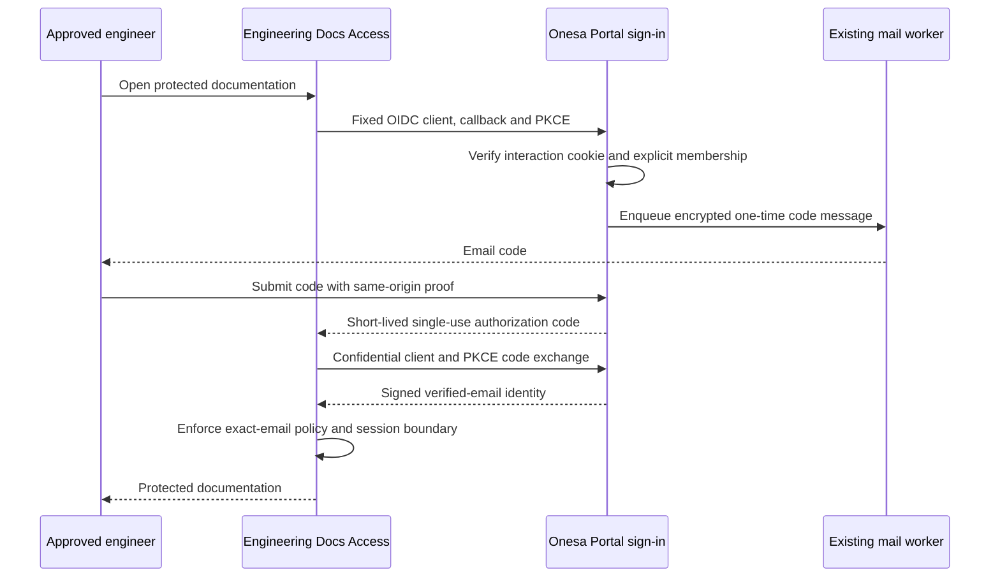

# Engineering Docs sign-in through Onesa Portal

Classification: INTERNAL. Owner: Onesa engineering owner. Status: prepared, not
activated. Source: the Portal identity module and additive migration 010. Last
source verification: 2026-10-17; hosted activation and owner sign-in remain separate.

Engineers use an individually approved email address and an emailed one-time code
on the Onesa Portal. They need neither a separate Docs password nor a Portal
administrator account. Existing Portal administration retains password/MFA.
Cloudflare Access continues protecting every Engineering Docs hostname and asset.
This identity provider is limited to that documentation application; it does not
merge Company, AI or Robot accounts.

## Configuration and deployment order

Use the existing staging and production Portal services, isolated databases and
mail configuration. Do not copy a production identity signing key into tests or
reuse backup encryption keys, administrator passwords or mail credentials for OIDC.
`ENGINEERING_IDENTITY_ENABLED` defaults off. Its root-only
`ENGINEERING_OIDC_CONFIG_B64` contains the exact issuer, one confidential client,
fixed Access callback, dedicated RSA signing JWK, cookie keys and approved external
emails. Values never belong in examples, screenshots, Git, CI or docs.
Frontend `ENGINEERING_SIGNIN_ENABLED` is independently off by default;
`ENGINEERING_ACCESS_CALLBACK_URL` is the exact approved callback, not a free redirect.
The issuer is the configured Portal origin plus `/api/v1/engineering-identity`.

1. Pass source, migration, isolated protocol/UI and required CI checks.
2. Verify backup/target and apply additive 010 in staging; grant the restricted
   app role CRUD only on its three tables. Preserve every existing account/record.
3. Qualify the staged API, worker and frontend using synthetic identities and
   isolated mail. Never add deployment credentials to dependency PRs.
4. Promote normally and activate qualified production code before selecting the
   new identity provider in the existing Docs Access applications.
5. Configure only that application's fixed confidential OIDC client, PKCE S256,
   authorization/token/JWKS endpoints and signed email claim. Preserve its audiences,
   aliases, eight-hour session limit, exact membership and private-file protections.
   Do not modify unrelated applications or the global OTP login method.
6. Complete the owner's actual emailed-code sign-in and verify protected HTML,
   search, diagrams and PDFs alongside anonymous/wrong-identity denials.
7. Record actual provider receipts, source/configuration hashes and rollback in
   the existing restricted release evidence. A prepared configuration is not live.

Cloudflare's [generic OIDC integration](https://developers.cloudflare.com/cloudflare-one/integrations/identity-providers/generic-oidc/)
uses the email in the signed ID token. The fixed provider deliberately includes
requested email claims there and also supports standard userinfo. The confidential
client accepts authorization-code flow only, requires PKCE, issues no refresh token,
and uses short code/ID-token lifetimes. Sources: installed `oidc-provider` 9.12.2
and official Cloudflare documentation accessed 2026-10-17. Published documentation
is not evidence that Onesa's provider has already been configured.

## Onboarding and offboarding

The owner uses **Portal → Users → Engineering Docs access**. First approve the
individual address in the existing exact-email Access policy and its existing
alias/asset authorization bindings. Record that verification reference when enabling
the same address in Portal. Individual `@onesa.eu` addresses are eligible for approval;
there is no automatic all-domain grant. Preserve the existing approved external
member `andrewgotora@yahoo.com`; other external addresses require an explicit
configuration/owner decision. No membership creates a Portal admin, AI user or Robot
operator. Stale membership revisions fail with 409 rather than overwrite another edit.

To offboard, disable the membership with fresh owner proof, revoke its existing
Access sessions and remove its exact email from the Docs policy/alias bindings.
Portal disables new sign-ins and removes its pending challenges and indexed identity
records. Already-issued Access sessions are a separate boundary and must be revoked
there; never claim that Portal alone terminates them instantly.

## Failure handling and rollback

Unknown, disabled and unapproved addresses receive the same code-request response;
only enabled approved members enqueue mail. Missing/expired/wrong-cookie interactions,
wrong Origin/CSRF, expired/replayed codes, excessive attempts and invalid callbacks
fail closed. Do not send a code, session or Access bypass token to a crawler.
A delivery failure stays visible in existing worker monitoring; provider acceptance
is not inbox receipt. Codes are never logged or stored as plaintext job text.

If the identity integration fails, restore only the recorded previous Docs login
method/application selection and configuration. Preserve exact email membership and
private Access protections. Disable the new feature flags after reconciling active
sign-ins; do not drop additive tables, erase audit history or reset account credentials.
Existing Portal administration remains independently available. Isolated restore lockdown disables restored memberships and invalidates all restored
Docs identity artifacts and codes before any reconciliation. It preserves membership
evidence and does not authorize a live restore. Protocol initiation/token/read rates
are independently bounded before provider interaction writes.

No blind code replay,
new signing key, global Access bypass or unrelated MFA change is a recovery step.

## Verification

The isolated protocol suite covers signed tokens, PKCE flow, exact callback,
cookie-bound interaction, Origin rejection, code expiry/attempt limits/concurrent
one-use redemption, encrypted storage, disabled membership and privilege isolation.
Frontend unit tests reject callback/path/issuer substitution and duplicate parameters.
Production claims require the actual hosted receipts and owner sign-in described
above; local tests are not that evidence. This is developer verification, not an
independent audit or authentication certification.
