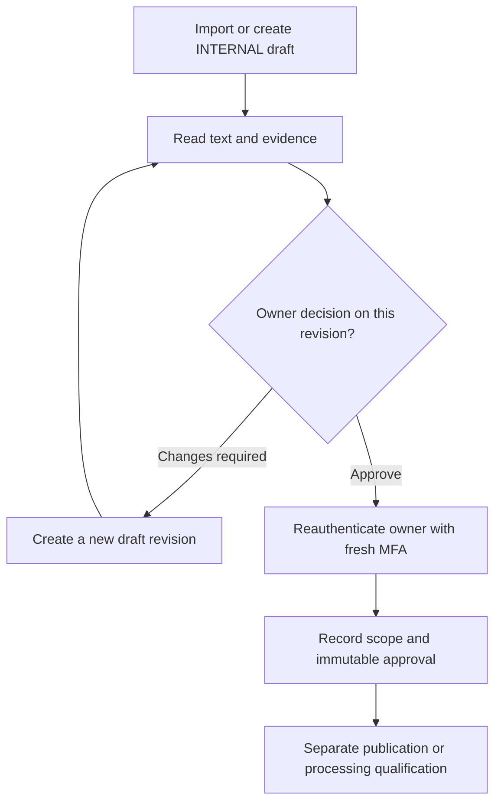
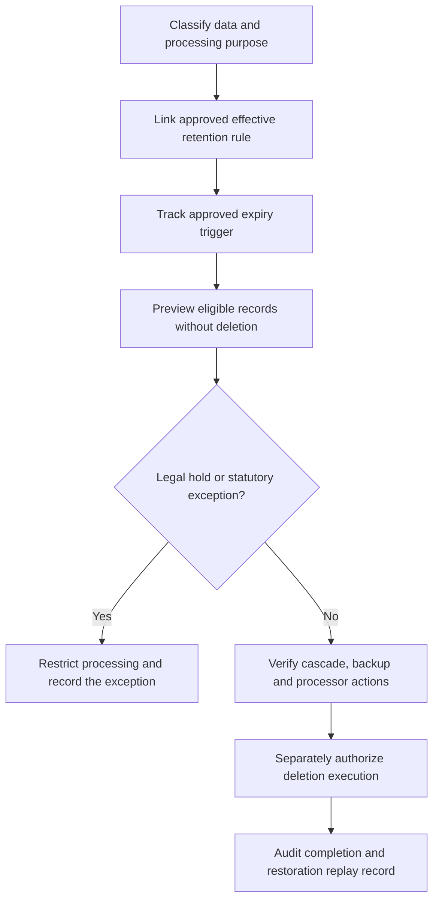
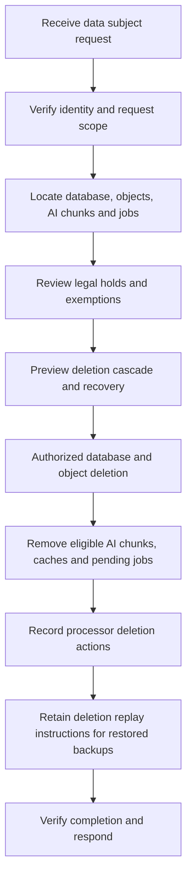
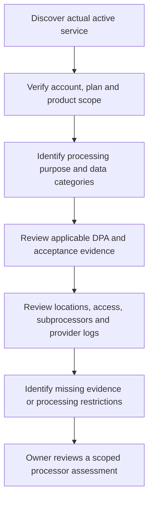
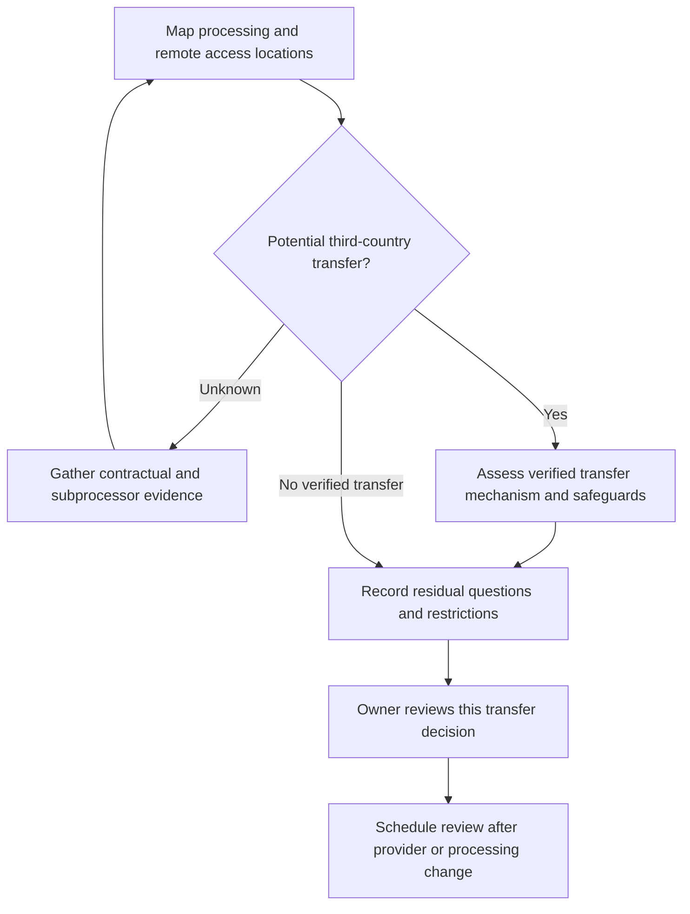
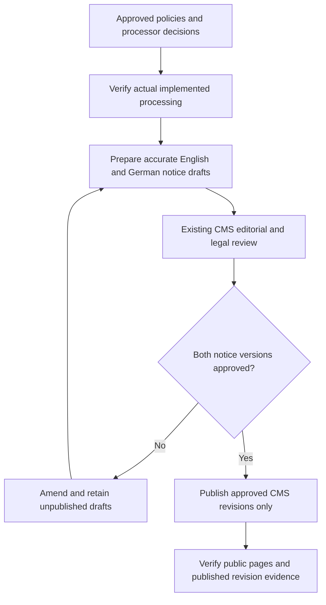
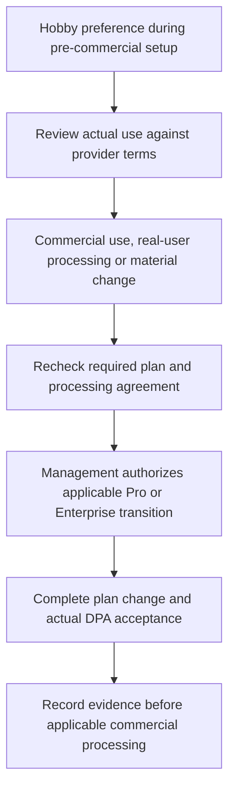

# Privacy governance architecture

Classification: INTERNAL engineering documentation. Detailed policy content, account
assessments, evidence and approval records live in the protected Portal database;
never copy the owner's draft package into Git, public documentation or static assets.

The existing Fastify API, PostgreSQL migration framework, session/MFA authentication,
CSRF controls and Next.js Company workspace implement this feature. No additional
database, application server or public document-storage service is introduced.
Open **Governance & Compliance → Privacy & Data Processing** at
`/admin#privacy/overview` on the existing Portal hostname. Owner and administrator
roles can read and amend records; only the owner can approve or reject, with fresh
password and MFA proof. Other roles and anonymous requests are denied by the API.

## Records and classifications

Migration `008_privacy_governance.sql` adds `governance_records`, immutable
`governance_versions` and append-only `governance_events`. Stable IDs identify three
documents (`ONESA-PRIV-RET-001`, `ONESA-PRIV-PROC-001`, `ONESA-PRIV-DEC-001`), 16
retention proposals, nine processor assessments and 12 separate decisions. All are
INTERNAL; initial versions remain **Draft — pending review**. Company facts, existing
CMS revisions and publication flags are preserved.

The records link the recruitment/contact/private-upload/quarantine/job/AI/log/backup/
statutory categories to proposed periods, triggers, deletion methods and exceptions.
Read the actual schedule in **Retention & Deletion**; importing a proposal never makes
it effective. Provider records separately track plans, account references, DPA
applicability and acceptance evidence, geography, remote access, subprocessors,
transfers, provider logs, review triggers and assessment status. An EEA database
location does not establish the location of every provider processing activity.

Each amendment creates a new numbered revision. Approval captures the authenticated
owner ID/email/role, actual timestamp, exact revision, scope, evidence, effective date
and next review. SQL triggers prohibit changing or deleting an approved version or
an audit event. Optimistic revision checks and row locks reject concurrent stale edits.
Archiving retains all evidence. Previous approved revisions stay available while an
amendment is under review. Approval of one item does not approve the other items.



## Import and migration procedure

The private ZIP and extracted JSON/Markdown stay in the ignored
`private/privacy-governance/package/` directory with owner-only permissions. Import
uses the JSON and matching original document text; it does not execute package scripts.
The optional private reconciliation context records verified infrastructure facts and
management declarations without changing source drafts or fabricating approvals.

Before migrating, inspect the exact target identity, current checksums, CMS/users and
existing backups. Test migration and recovery on an isolated `_test` database and
then staging. Apply the reviewed additive migration with the existing operator
connection. Grant the existing restricted application role privileges on the three
new tables and sequence without changing its password. Verify readiness using the
application identity. Never run tests, TRUNCATE or resets against application data.

Run the existing backend operator command with privately supplied configuration:

```sh
npm run privacy:import -- ../private/privacy-governance/package/privacy_governance_seed.json \
  --context ../private/privacy-governance/reconciliation-context.json
```

The command requires existing `DATABASE_URL`, `SESSION_KEY`,
`PORTAL_EXPECTED_DB_HOST` and `PORTAL_EXPECTED_DB_NAME` plus normal application
configuration. Hosted imports accept only the independently verified Portal Neon
staging/production endpoints, `neondb`, the restricted `onesa_portal_app` identity,
certificate-verified TLS and required channel binding. Local imports accept only
isolated `onesa_portal*_test` databases. No URL, password or policy body is logged.
The transaction is serialized and insert-only. Existing drafts and approved/newer
records are preserved on rerun; missing children of a pre-existing document are
reported as skipped for operator review, rather than silently appended.

Recovery is restore-based; there is no destructive down migration. Older APIs tolerate
the extra tables. Keep the additive schema when rolling an application back. Verify
the restored governance counts, revisions, approvals, audit events and encryption key
before making a restored system available. Never copy staging data into production.

## Retention and deletion safeguards

Provisional legacy application/enquiry TTL settings no longer delete business records.
Existing security-session expiry, bounded-transfer cleanup and explicitly authorized
storage-deletion outbox processing retain their original behavior. No business-data
retention automation or data-subject-request executor is activated by governance.





## Processor and transfer review

Published provider legal documents are references, not acceptance evidence. Plan,
contractual applicability, actual acceptance, transfer mechanisms and logging
retention remain distinct fields and management decisions.





## Publication and Vercel transition

The owner declares a pre-commercial setup period and retains Hobby as the current
hosting preference. The plan readback and declaration are separate from contractual
eligibility. Record the actual use-case review as pending where unresolved.
[Vercel's published DPA](https://vercel.com/legal/dpa) identifies Pro and Enterprise;
it is the future contractual reference and is not recorded as currently effective
for Hobby. Consult the [terms](https://vercel.com/legal/terms) and
[fair-use guidelines](https://vercel.com/docs/limits/fair-use-guidelines) at transition.
No paid upgrade, DPA acceptance timestamp or contractual exception is invented.





## API, UI and evidence

All nine operations are under `/api/v1/admin/governance`: overview, filtered records,
record details, paginated versions, new revisions, review, archive/restore, events and
protected revision PDFs. Zod schemas generate OpenAPI and frontend operation types.
No manually copied DTOs or public governance API exists. Responses and PDFs are private
and uncached. Markdown and diagrams render through native escaped React/SVG elements;
no raw HTML, external script, image or diagram service executes document content.

Run the full backend suite, generated-contract checks, lint/type checks/builds and
`tests/governance.spec.ts` browser tests. The synthetic fixtures never include the
owner's real drafts. Hosted evidence must independently verify target identities,
actual database counts, insert-only reruns, owner/admin access, denied ordinary-user
access, private PDFs and production persistence. Local tests are not hosted acceptance.
Private source packages and hosted traces/screenshots must not enter public CI artifacts.
